```{r setup}
knitr::opts_knit$set(root.dir = normalizePath(".."))
suppressPackageStartupMessages({
  library(dplyr); library(readr); library(knitr); library(glue)
})
res <- tryCatch(readRDS("../outputs/census_anchor_results.RData"), error = function(e) NULL)
usd_npr <- 133
nums <- if (!is.null(res)) list(
  national_coi_b = round(res$coi_b_r09, 1), national_coi_b_r12 = round(res$coi_b_r12, 1),
  national_coi_usdm = round(res$coi_b_r09 * 1e9 / usd_npr / 1e6),
  national_excluded = round(res$N_excluded), girls_1524 = round(res$N_f1524_census),
  coi_pct_health_budget = round(100 * res$coi_b_r09 / 86.24, 1),
  coi_pct_ssallow_budget = round(100 * res$coi_b_r09 / 106, 1),
  coi_pct_education_budget = round(100 * res$coi_b_r09 / 203.66, 1),
  breakeven_usd = round(res$coi_b_r09 * 1e9 / usd_npr / res$N_excluded),
  girls_return_pct = 14.5, boys_return_pct = 12.0) else list(
  national_coi_b = 16.3, national_coi_b_r12 = 22.1, national_coi_usdm = 123,
  national_excluded = 1425831, girls_1524 = 3214885,
  coi_pct_health_budget = 18.9, coi_pct_ssallow_budget = 15.4, coi_pct_education_budget = 8.0,
  breakeven_usd = 86, girls_return_pct = 14.5, boys_return_pct = 12.0)
```

# Data and Context {.section-divider background-color="#00377C"}

## Data Source: Nepal Living Standards Survey IV (NLSS IV) 2022/23 {.smaller}

- **Source**: National Statistics Office of Nepal · NLSS IV 2022/23 microdata
- **Sampling**: Nationally representative two-stage stratified design across 7 provinces
- **Sample size**: 46,870 individuals in 9,600 households
- **Analysis sample**: 9,785 youth aged 15–24 (4,919 girls, 4,866 boys); 13,586 women aged 15–64 for the causal forest
- **Modules used**: S01 (roster), S07 (education), S08 (disability, Washington Group), S09 (employment), S10 (wages), poverty file
- **Survey design**: PSU = `psu_number`, strata = province, weights = `ind_wt`

## Variables and Definitions {.smaller}

| Concept | Definition | Source |
|---|---|---|
| **NEET** | Not in education, employment or training | S07 + S09 |
| **Enrolled** | Currently attending any school level | q07_11 |
| **Secondary completed** | Completed Class 10 (SLC) or higher | q07_12 |
| **Currently married** | Self-reported marital status | q01_05 |
| **Caste/ethnicity** | 8 NLSS groups, recoded to 5 broad categories | q01_07 |
| **Wealth quintile** | Asset-based, household level | constructed |
| **Below poverty line** | Official NSO poverty status | poverty file |
| **Disability** | Washington Group 6+ functional difficulty | q08_16–q08_21 |
| **Monthly wage** | Long-term salaried workers, NPR | q10_07, q10_09 |

# Key Findings at a Glance {.section-divider background-color="#00377C"}

## Five Headline Findings {.smaller}

```{=latex}
\begin{itemize}\setlength\itemsep{0.9em}
\item[\textbf{1.}] Nepal's gender gap is \textbf{not in schools} — it is in labour markets. Girls' enrolment (40.2\%) exceeds boys' (34.8\%), yet NEET (46.8\%) is nearly double boys' (26.4\%).
\item[\textbf{2.}] \textbf{Marriage is the strongest driver of exclusion, and it begins in adolescence.} Being currently married is associated with a 61 pp reduction in enrolment and a 42 pp increase in NEET, dwarfing poverty, caste, and disability combined. The share married rises from 9\% at ages 15--18 (where any current marriage is child marriage by definition) to 57\% at 19--24.
\item[\textbf{3.}] \textbf{Secondary education has a robust estimated effect on inclusion}: a $-$13.2 pp reduction in NEET probability, stable across all provinces and caste groups (causal forest, n = 13{,}586).
\item[\textbf{4.}] \textbf{Each additional year of schooling is associated with a 14.5\% rise in lifetime earnings for girls vs 12.0\% for boys.} Beyond secondary completion the gap \textit{widens}: $\sim$+15\% per year for girls vs $\sim$+10\% per year for boys — the heart of the cost of inaction.
\item[\textbf{5.}] \textbf{Nepal forgoes $\sim$NPR 16 billion (USD 123 million) per cohort} by not educating its adolescent girls, equivalent to \textbf{$\sim$19\% of the annual health-sector budget}, $\sim$15\% of the social-security-allowance budget, and $\sim$8\% of the education budget. Population counts are anchored to the 2021 Census.
\end{itemize}
```

# Diagnostic: Gender Gaps in Education and Employment {.section-divider background-color="#00377C"}

## The Gender Gap is Not in Schools — It is in Labour Markets

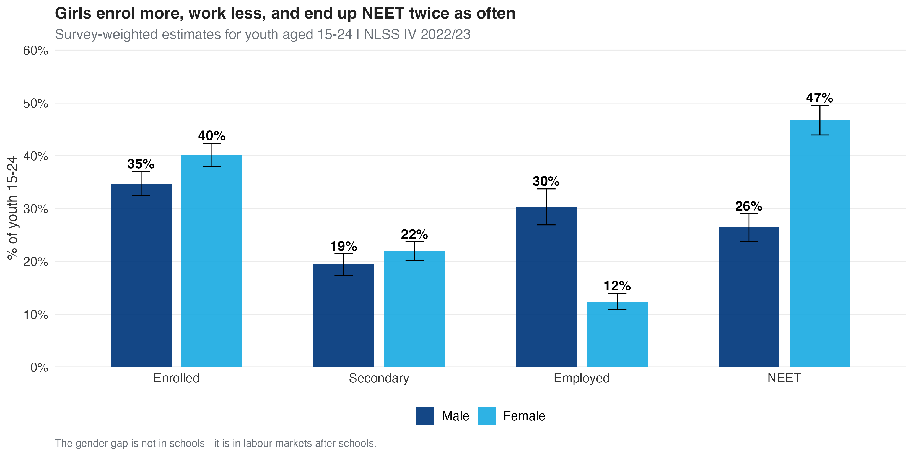{fig-align="center" width="86%"}

## Madhesh and Lumbini: Provinces with the Widest Female NEET Gap

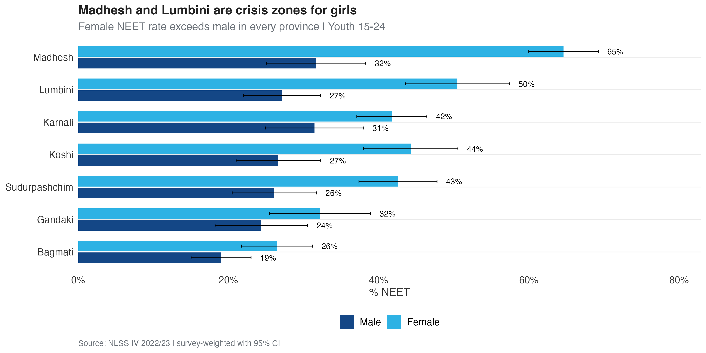{fig-align="center" width="76%"}

## Marriage Rises Sharply Across the Adolescent Transition

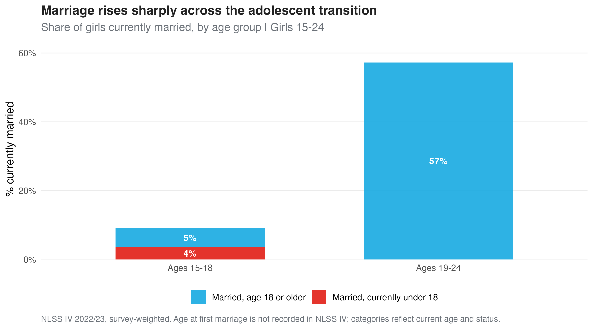{fig-align="center" width="74%"}

::: {style="font-size: 0.35em; color: #555; margin-top: 4px;"}
NLSS IV records current marital status, not age at first marriage. Among 15–18-year-olds any current marriage is child marriage by definition; for 19–24-year-olds only current status is observed.
:::

## The Marriage Penalty on NEET Holds in Both Age Groups, Regardless of Caste

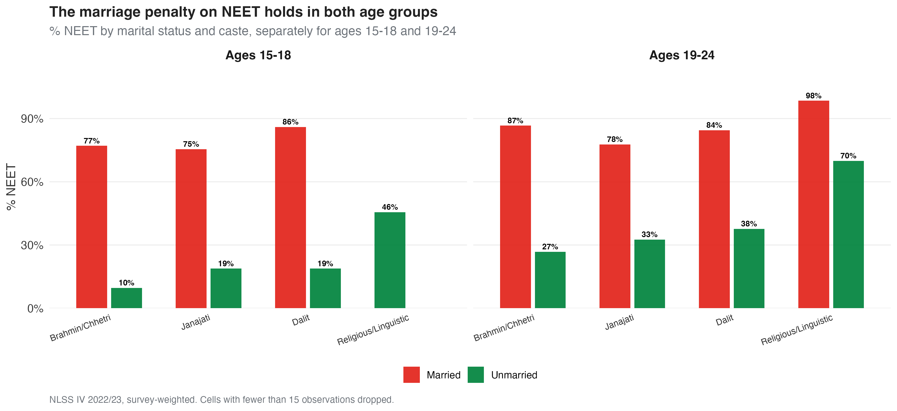{fig-align="center" width="92%"}

## Married Girls' Enrolment Collapses in Both Age Groups, Across All Castes

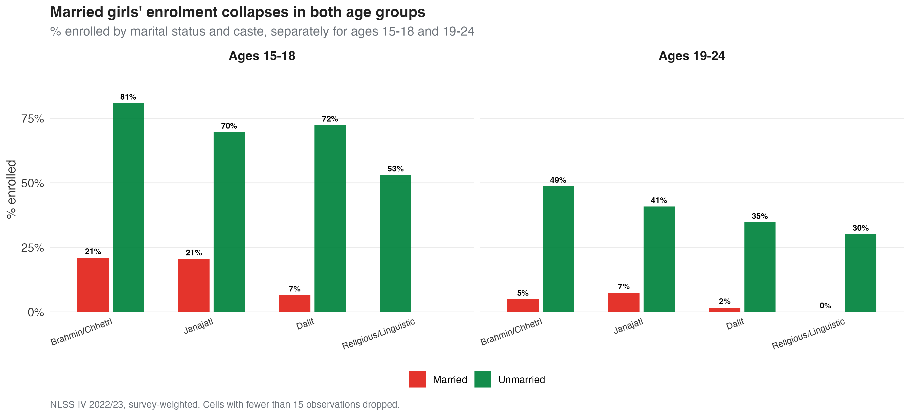{fig-align="center" width="92%"}

## Headline Numbers — Where Each Girl Aged 15–24 Is {.smaller}

| Status (youth 15–24)               | Girls           | Boys           | Gap (pp)         |
|------------------------------------|-----------------|----------------|------------------|
| In school only (not working)       | 35.4%           | 32.8%          | +2.6 pp          |
| In school **and** working          | 4.8%            | 2.0%           | +2.8 pp          |
| Working only (not in school)       | 13.0%           | 38.9%          | **−25.9 pp**     |
| **NEET** (Not in Educ/Employment)  | **46.8%**       | **26.4%**      | **+20.4 pp**     |
| *Of which: currently married*      | 37.4%           | 17.6%          | +19.8 pp         |

::: {style="font-size: 0.35em; color: #555; margin-top: 6px;"}
The 46.8% NEET figure reflects girls who are *neither* in school *nor* employed under the ILO 7-day definition (which excludes unpaid family work and unsuccessful job search). These four categories are mutually exclusive and sum to 100%.
:::

# Multivariate Analysis {.section-divider background-color="#00377C"}

## What is Associated with Girls' Enrolment: All Factors in Percentage Points

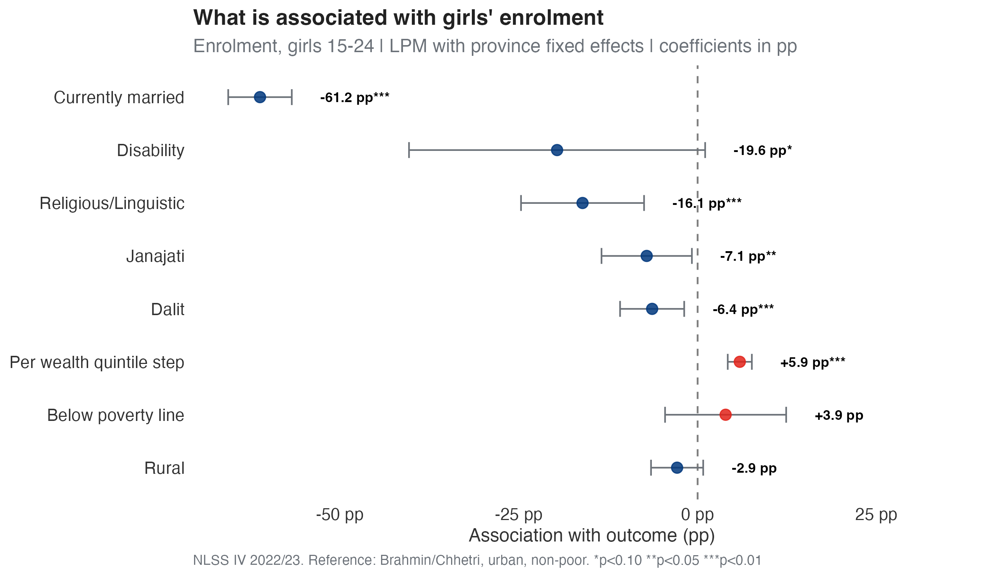{fig-align="center" width="80%"}

## What is Associated with Youth NEET: All Factors in Percentage Points

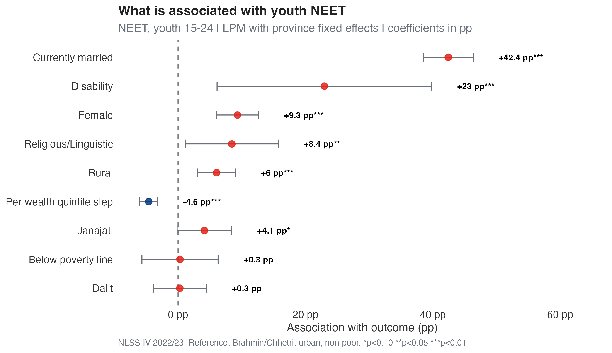{fig-align="center" width="80%"}

## The Marriage Association Strengthens with Age; Other Factors are Stable

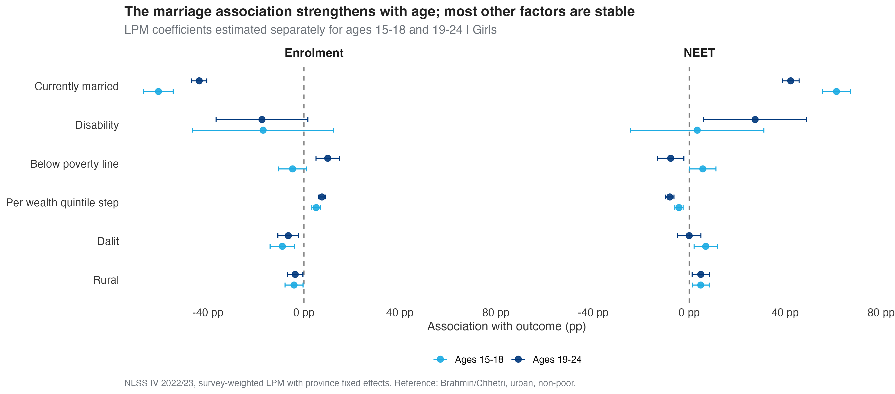{fig-align="center" width="92%"}

## Reading the Coefficient Plot {.smaller}

- **Marriage is associated with the largest changes.** Being currently married is associated with a **−61 pp** lower enrolment probability and a **+42 pp** higher NEET probability, after controlling for poverty, caste, geography, and disability.

\vspace{0.6em}

- **Caste matters even after wealth.** Dalit girls face a −6 pp enrolment gap that does not disappear when we control for wealth quintile. Religious/Linguistic girls face a similar penalty.

\vspace{0.6em}

- **Wealth helps incrementally.** Each step up in the wealth quintile is associated with +5.9 pp enrolment and −4.6 pp NEET.

\vspace{0.6em}

- **The gender coefficient on NEET remains +9.3 pp** even after holding everything constant — a residual labour-market gap not explained by observable characteristics.

# Estimating Education Returns for Adolescent Girls {.section-divider background-color="#00377C"}

## Secondary Education Reduces NEET by ~13 pp — For Every Caste

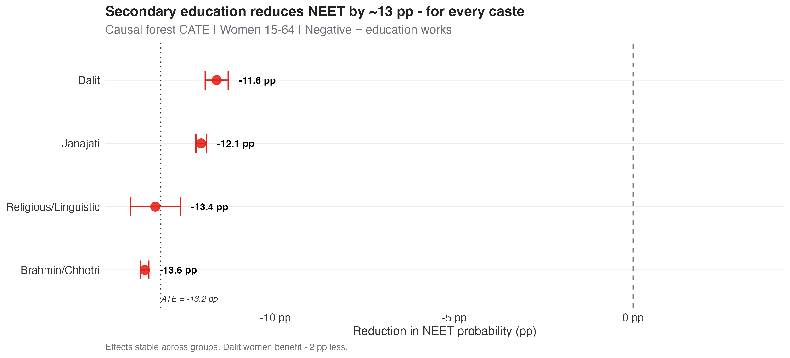{fig-align="center" width="74%"}

::: {style="font-size: 0.35em; color: #555; margin-top: 4px;"}
The −13.2 pp ATE estimate is for **women aged 15–64**. The parallel estimate for men is smaller (~−7 pp) — boys' NEET is shaped more by labour-demand conditions than by individual schooling. Causal-forest details and boys' coefficients in the appendix.
:::

## Returns to Schooling are Exponentially Larger for Girls

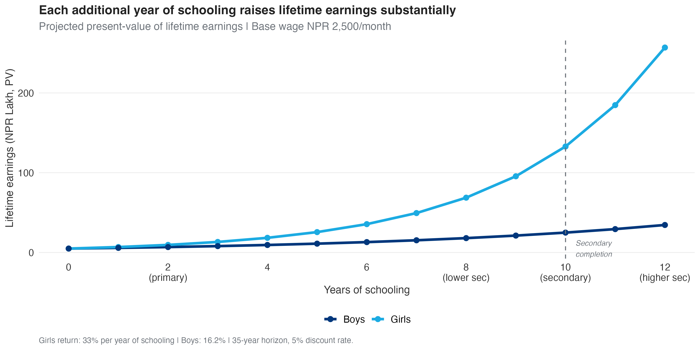{fig-align="center" width="74%"}

::: {style="font-size: 0.32em; color: #555; line-height: 1.25; margin-top: 4px;"}
**Average Mincer return:** +14.5% per year of schooling for girls vs +12.0% for boys. **Beyond secondary** (10+ years): each additional year of schooling adds ~+15% to girls' lifetime earnings vs ~+10% for boys — the gender gap in returns *widens* with educational attainment. Compounded over 35 working years, this is where the cost of inaction concentrates.
:::

## Marriage Erodes the Protective Effect of Education

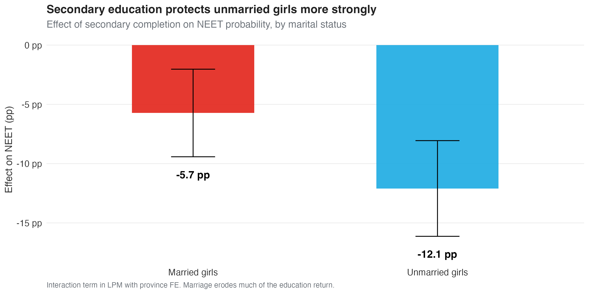{fig-align="center" width="80%"}

## What the Analyses Tell Us {.smaller}

- **Education is associated with inclusion everywhere.** Completing secondary school is associated with a **−13.2 pp** lower NEET probability. The estimated effect is stable across all 7 provinces and all caste groups.

\vspace{0.6em}

- **The Mincer return per year of schooling is `r nums$girls_return_pct`% for girls** (`r nums$boys_return_pct`% for boys). After 10 years of schooling, projected lifetime earnings roughly **double** relative to no schooling.

\vspace{0.6em}

- **Marriage attenuates the protective association.** Education is strongly associated with lower NEET for unmarried girls, but the relationship is weaker among married girls — education and marriage prevention act as **complements**, not substitutes.

\vspace{0.6em}

- **OLS and causal forest produce convergent estimates** in direction, magnitude, and stability. The investment case rests on triangulated evidence from two independent methods.

# The Cost of Inaction {.section-divider background-color="#00377C"}

## Nepal Forgoes NPR 16 Billion Every Year by Not Educating its Girls

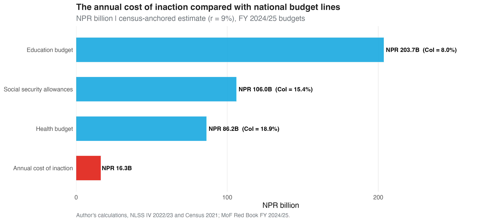{fig-align="center" width="84%"}

## Where the Cost Falls: Provincial Distribution

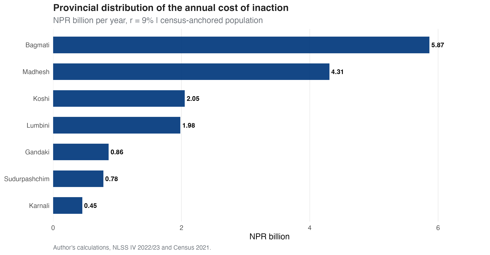{fig-align="center" width="78%"}

## What This Means in Concrete Policy Terms {.smaller}

- **NPR `r nums$national_coi_b` billion (USD `r nums$national_coi_usdm` million)** is the lifetime productivity loss from **one cohort** of `r format(nums$national_excluded, big.mark = ",")` adolescent girls who will not complete secondary education. Counts are **census-anchored**: NLSS IV proportions applied to the 2021 Census female population (`r format(nums$girls_1524, big.mark = ",")` girls aged 15–24), because raw survey weights overstate population totals about fivefold.

\vspace{0.5em}

- That equals about **`r nums$coi_pct_health_budget`% of the national health-sector budget** (NPR 86.2B, FY2024/25), **`r nums$coi_pct_ssallow_budget`% of the social security allowance budget** (NPR 106B, FY2022/23), and **`r nums$coi_pct_education_budget`% of the education-sector budget** (NPR 203.7B, FY2024/25).

\vspace{0.5em}

- **Karnali, Sudurpashchim, and Madhesh** carry the largest relative burden — per-girl losses are smaller than in Bagmati because wages are lower, but a larger share of the local economy is at stake.

\vspace{0.5em}

- **"Per cohort" means** the *lifetime* productivity loss for the current cohort of `r format(nums$national_excluded, big.mark = ",")` adolescent girls (aged 15–24 today). A new cohort enters this stage every year, so this is a **recurring annual loss**, not one-off. Using the boys' 12% wage premium instead of the 9% ILO benchmark gives NPR `r nums$national_coi_b_r12` billion: the headline is the conservative floor.

\vspace{0.5em}

- **Break-even spending per girl.** USD `r nums$national_coi_usdm` million ÷ `r format(nums$national_excluded, big.mark = ",")` girls ≈ **USD `r nums$breakeven_usd` per girl** in cumulative lifetime social spending. *Important caveat:* this break-even assumes every girl who completes secondary education enters the labour market and earns the median wage — which overstates realised returns, since many will not enter wage work. The figure is best read as the **theoretical maximum** spend that would still break even, not a prediction of per-girl returns.

# Recommendations {.section-divider background-color="#00377C"}

## Four Priority Areas for Investment: Employment Opportunities First {.smaller}

```{=latex}
\begin{itemize}\setlength\itemsep{0.8em}
\item[\textbf{1.}] \textbf{Livelihoods: pathways from education to employment.} Every gain in this report assumes jobs exist for newly qualified young women; the estimates are partial-equilibrium and depend on labour demand. Pair education with demand-side measures: skills bridges from upper-secondary to work, TVET, apprenticeships, second-chance and return-to-education pathways, and investment in employment-generating sectors. This is an explicit budget trade-off, to be planned together with education rather than in competition with it.
\item[\textbf{2.}] \textbf{Education: universal secondary completion with year-by-year retention.} Each year of schooling is associated with a 14.5\% earnings premium for girls, and returns are \textit{convex}, rising from $\sim$8\% at primary to $\sim$27\% at secondary and $\sim$35\% at higher secondary. Programme design should reward \textit{every year retained}, with the largest gains in upper-secondary.
\item[\textbf{3.}] \textbf{Marriage: treat prevention as an economic priority, starting in adolescence.} Marriage is associated with more variation in girls' NEET than poverty, caste, and disability combined; the married share rises from 9\% at ages 15--18 to 57\% at 19--24, and the penalty is severe in both groups. Dropout is itself a risk factor for child marriage, so retention and prevention reinforce each other. Enforcement, concentrated in Madhesh and Lumbini, must reach girls \textit{before} the post-18 transition.
\item[\textbf{4.}] \textbf{Equity: close the gaps facing Dalit girls.} Education alone leaves Dalit women with a residual labour-market disadvantage that does not disappear when controlling for wealth. Pair education investment with apprenticeships, targeted scholarships, and anti-discrimination measures.
\end{itemize}
```

# Methodological Appendix {.section-divider background-color="#00377C"}

## How We Estimate the Cost of Inaction {.smaller}

We combine three components:

\vspace{0.4em}

::: {.columns}
::: {.column width="50%"}

**1 · Causal effect**

Generalised Random Forest (Wager & Athey 2018) on women 15–64, treatment = secondary completion, outcome = NEET. ATE = −13.2 pp.

\vspace{0.8em}

**2 · Earnings projection**

Mincer wage equation on 952 women in long-term salaried employment. Conservative return = 9% per year of schooling (ILO benchmark, lower than the internal estimate of 14.5%).

:::
::: {.column width="50%"}

**3 · Population scaling**

Census-anchored: NLSS IV weighted proportions applied to the Census 2021 female population (14.9M) give 3.21M girls aged 15–24, of whom 1.43M do not complete secondary. Provincial CoI = ATE × N excluded × PV per girl.

\vspace{0.8em}

**Discount rate**: 5% | **Horizon**: 35 working years | **GDP source**: NSO Nepal 2023/24 provincial accounts.

:::
:::

## Assumptions and Limitations {.smaller}

```{=latex}
\begin{itemize}\setlength\itemsep{0.9em}
\item[\textbf{1.}] \textbf{Formal-sector selection bias.} Wages are observed only for the $\sim\,$25\% of women in wage employment. We test for this with a Heckman selection model (see appendix): selection is statistically significant ($\rho=0.34$, $p<0.01$) but correcting for it shifts the estimated return by less than 2 pp, so the Mincer estimates are robust within that specification; the selection test uses its own specification, whose uncorrected baseline (24.4\%) differs from the main model's 14.5\%. The conservative 9\% ILO benchmark sits below all estimates.
\item[\textbf{2.}] \textbf{NEET-to-earnings transition.} The estimate assumes a girl who exits NEET earns the median wage \textit{immediately}. In reality, job search, childcare, mobility, and social norms create friction that delays or reduces actual earnings. Assuming instant median-wage access therefore \textbf{overstates} the realised gain, making the cost-of-inaction figure an \textbf{upper bound} on what is realistically recoverable.
\item[\textbf{3.}] \textbf{Male migration not captured.} Boys leaving school for foreign employment generates remittances. The analysis does not yet quantify the parallel earnings that educated girls could generate through skilled migration.
\item[\textbf{4.}] \textbf{Population scaling.} Raw NLSS IV weights sum to 163.5M people against a census population of 29.2M, so absolute counts use survey proportions applied to the Census 2021 base. This revision, prompted by the country office review, doubled the headline relative to earlier drafts; proportions and per-girl results are unchanged.
\item[\textbf{5.}] \textbf{Partial equilibrium.} Earnings gains are valued at current wages and current labour demand, and assume employment opportunities exist for those who become qualified. If many more girls completed secondary at once, wages and job availability would adjust, so the average gain would be smaller than the marginal gain estimated here.
\end{itemize}
```

## The Mincer Wage Equation: Specification {.smaller}

The Mincer human-capital earnings function is estimated as:

$$
\log(\text{wage}_{ip}) = \alpha + \beta_1 \cdot \text{schooling}_{ip} + \beta_2 \cdot \text{exp}_{ip} + \beta_3 \cdot \text{exp}^2_{ip} + \beta_4 \cdot \text{rural}_{ip} + \gamma_p + \varepsilon_{ip}
$$

::: {style="font-size: 0.35em;"}
- $\log(\text{wage}_{ip})$ — natural log of monthly wage (NPR) for individual $i$ in province $p$
- $\beta_1$ — **key parameter**: return per additional year of schooling (Mincer return)
- $\text{exp}$ — years of potential labour market experience (age − schooling − 6)
- $\text{exp}^2$ — captures concavity (returns to experience diminish with age)
- $\text{rural}$ — binary indicator for rural residence
- $\gamma_p$ — province fixed effects (regional wage differentials)
- $\varepsilon_{ip}$ — error term, heteroskedasticity-robust SE (HC1)

**Specifications tested:** (i) Basic — schooling, experience, rural; (ii) +Province FE; (iii) +Caste/ethnicity controls; (iv) Interactions with marital status. The reported estimate $\hat{\beta}_1 \approx 0.145$ implies a **14.5% return per year of schooling** for women; ILO Nepal benchmark of 9% used for the conservative CoI.
:::

## Appendix Table A1: Mincer Wage Equation, Female Salary Workers {.smaller}

```{r}
#| label: mincer-girls
if (file.exists("outputs/tables/mincer_girls_full.csv")) {
  mincer_girls <- read_csv("outputs/tables/mincer_girls_full.csv", show_col_types = FALSE)
  knitr::kable(mincer_girls, align = "lrrrr", caption = NULL, format = "simple")
}
```

::: {style="font-size: 0.35em; color: #555; line-height: 1.25; margin-top: 4px;"}
*Notes:* Dependent variable is log of monthly wage (NPR). Sample: women aged 15–64 in long-term salaried employment (N = 952). Specification includes years of schooling, experience, experience squared, rural indicator, and province fixed effects. Standard errors are heteroskedasticity-robust (HC1). *Source*: Author's calculations using NLSS IV 2022/23. \*p < 0.10, \*\*p < 0.05, \*\*\*p < 0.01.
:::

## Appendix Table A2: Mincer Wage Equation, Male Salary Workers {.smaller}

```{r}
#| label: mincer-boys
if (file.exists("outputs/tables/mincer_boys_full.csv")) {
  mincer_boys <- read_csv("outputs/tables/mincer_boys_full.csv", show_col_types = FALSE)
  knitr::kable(mincer_boys, align = "lrrrr", caption = NULL, format = "simple")
}
```

::: {style="font-size: 0.35em; color: #555; line-height: 1.25; margin-top: 4px;"}
*Notes:* Dependent variable is log of monthly wage (NPR). Sample: men aged 15–64 in long-term salaried employment. Specification includes years of schooling, experience, experience squared, rural indicator, and province fixed effects. Standard errors are heteroskedasticity-robust (HC1). *Source*: Author's calculations using NLSS IV 2022/23. \*p < 0.10, \*\*p < 0.05, \*\*\*p < 0.01.
:::

## Appendix Figure A1: Gender Gap by Age Group

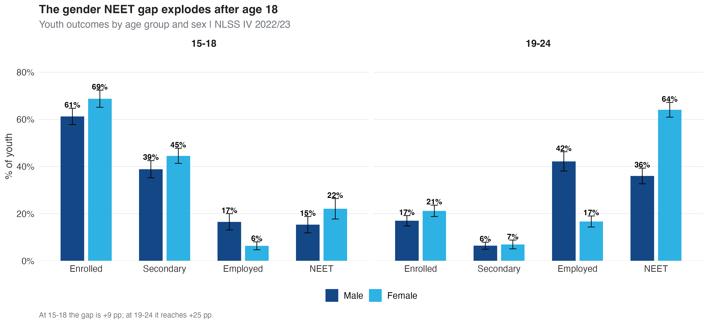{fig-align="center" width="92%"}

## Appendix Figure A2: Boys' NEET Regression — Coefficient Plot

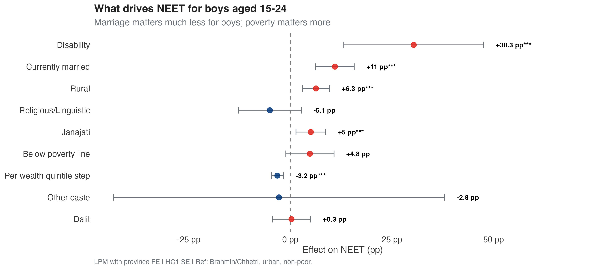{fig-align="center" width="86%"}

## Appendix Table A3: Boys' NEET Linear Probability Model {.smaller}

```{r}
#| label: boys-reg
if (file.exists("outputs/tables/boys_reg_full.csv")) {
  boys_reg <- read_csv("outputs/tables/boys_reg_full.csv", show_col_types = FALSE)
  knitr::kable(boys_reg, align = "lrrrr", caption = NULL, format = "simple")
}
```

::: {style="font-size: 0.35em; color: #555; line-height: 1.25; margin-top: 4px;"}
*Notes:* Dependent variable is NEET status. Linear probability model. Sample: boys aged 15–24 (n ≈ 4,300). Controls: rural, poverty status, wealth quintile, marital status, disability (WG 6+), caste/ethnicity. Reference categories: Brahmin/Chhetri, urban, non-poor. Province fixed effects included. Standard errors are heteroskedasticity-robust (HC1). *Source*: Author's calculations using NLSS IV 2022/23. \*p < 0.10, \*\*p < 0.05, \*\*\*p < 0.01.
:::

## Appendix: Heckman Selection Model {.smaller}

Wages are observed only for women in wage employment (about 25% of working-age women). If the women who work differ systematically from those who do not, the Mincer return could be biased. We test this with a Heckman (1979) two-step model.

```{=latex}
\begin{itemize}\setlength\itemsep{0.6em}
\item \textbf{Selection equation} (probit): probability of being in the wage sample, with exclusion restrictions — children under 5, other adult women in household, household size, and wealth quintile (factors affecting participation, not the wage itself).
\item \textbf{Outcome equation}: the Mincer wage equation, corrected for selection via the inverse Mills ratio.
\item \textbf{Result}: selection is statistically significant ($\rho = 0.34$, inverse Mills ratio $p < 0.01$) — there \textit{is} positive selection into wage work. But the correction changes the estimated return by less than 2 pp.
\item \textbf{Interpretation}: the Mincer estimates are robust to selection. This is \textit{not} a causal-identification claim (that rests on the causal forest); it addresses only sample selection into observed wages.
\end{itemize}
```

## Appendix: Returns are Robust Across Specifications {.smaller}

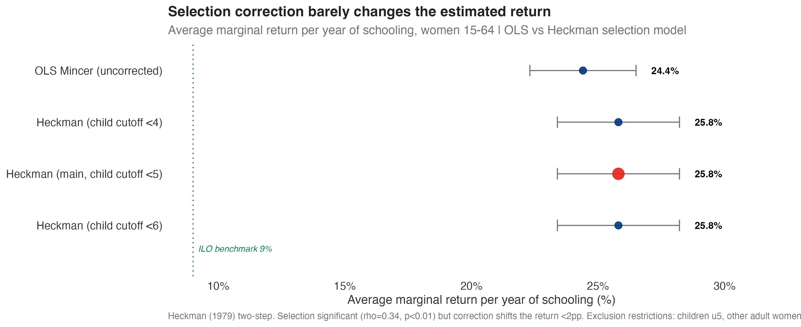{fig-align="center" width="82%"}

::: {style="font-size: 0.34em; color: #555; margin-top: 2px;"}
Average marginal return per year of schooling, women 15–64. The OLS (uncorrected, 24.4%) and Heckman-corrected (25.8%) estimates are nearly identical, and stable across the choice of child-age cutoff in the exclusion restriction. This test runs on its own specification; the 14.5% headline return comes from the main Mincer model, so the test speaks to stability under selection, not to the level of the headline. The 9% ILO benchmark used for the cost-of-inaction calculation is far below all estimates — making the CoI a conservative figure. Returns are convex: marginal return rises from ~8% at primary to ~27% at secondary and ~35% at higher secondary.
:::

##  {.unnumbered}

\vfill

\begin{center}
{\fontsize{28pt}{34pt}\selectfont\bfseries\color{black} Thank you\par}
\vspace{1em}
{\fontsize{15pt}{18pt}\selectfont\color{uniceflight} hgrueso@unicef.org\par}
\end{center}

\vfill
