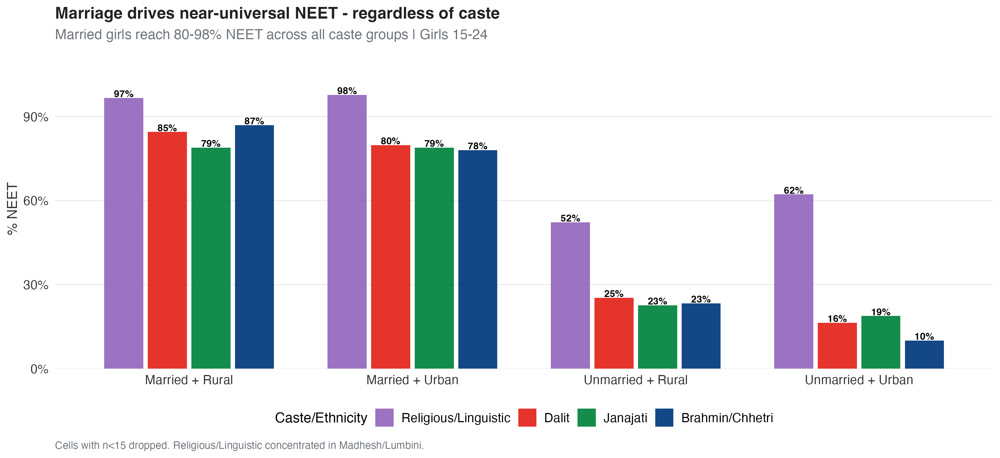
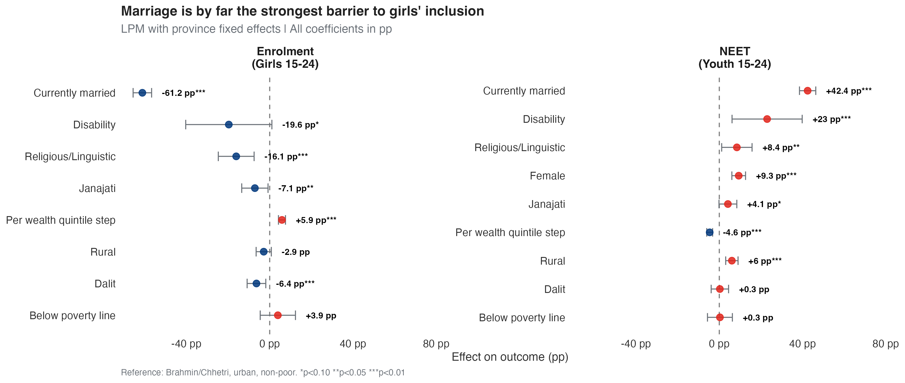
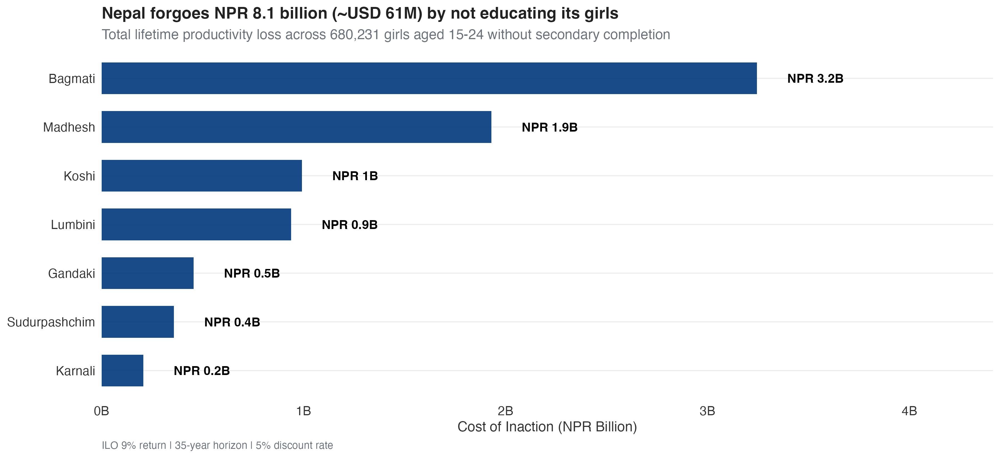
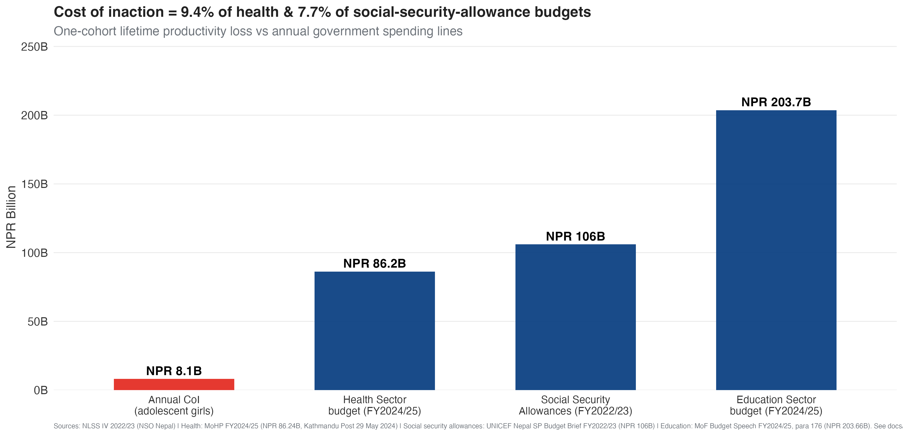

```{r setup}
knitr::opts_knit$set(root.dir = normalizePath(".."))
suppressPackageStartupMessages({
  library(dplyr); library(readr); library(knitr); library(glue)
})
nums <- tryCatch(readRDS("../outputs/coi_summary_numbers.RData"),
                 error = function(e) list(
                   national_coi_b = 8.1, national_coi_usdm = 61,
                   national_excluded = 680231,
                   coi_pct_health_budget = 10, coi_pct_education_budget = 4,
                   girls_return_pct = 14.5, boys_return_pct = 12.0))
```

# Data and Context {.section-divider background-color="#00377C"}

## Data Source: Nepal Living Standards Survey IV (NLSS IV) 2022/23 {.smaller}

- **Source**: National Statistics Office of Nepal · NLSS IV 2022/23 microdata
- **Sampling**: Nationally representative two-stage stratified design across 7 provinces
- **Sample size**: 46,870 individuals in 9,600 households
- **Analysis sample**: 9,785 youth aged 15–24 (4,919 girls, 4,866 boys); 13,586 women aged 15–64 for the causal forest
- **Modules used**: S01 (roster), S07 (education), S08 (disability, Washington Group), S09 (employment), S10 (wages), poverty file
- **Survey design**: PSU = `psu_number`, strata = province, weights = `ind_wt`

## Variables and Definitions {.smaller}

| Concept | Definition | Source |
|---|---|---|
| **NEET** | Not in education, employment or training | S07 + S09 |
| **Enrolled** | Currently attending any school level | q07_11 |
| **Secondary completed** | Completed Class 10 (SLC) or higher | q07_12 |
| **Currently married** | Self-reported marital status | q01_05 |
| **Caste/ethnicity** | 8 NLSS groups, recoded to 5 broad categories | q01_07 |
| **Wealth quintile** | Asset-based, household level | constructed |
| **Below poverty line** | Official NSO poverty status | poverty file |
| **Disability** | Washington Group 6+ functional difficulty | q08_16–q08_21 |
| **Monthly wage** | Long-term salaried workers, NPR | q10_07, q10_09 |

# Diagnostic: Gender Gaps in Education and Employment {.section-divider background-color="#00377C"}

## The Gender Gap is Not in Schools — It is in Labour Markets

{fig-align="center" width="86%"}

## Madhesh and Lumbini are Crisis Zones for Adolescent Girls

{fig-align="center" width="80%"}

## Marriage Drives Near-Universal NEET — Regardless of Caste

{fig-align="center" width="90%"}

## Headline Numbers — The Gender Gap in One Slide

| Indicator (youth 15–24)            | Girls           | Boys           | Gap (pp)         |
|------------------------------------|-----------------|----------------|------------------|
| Currently enrolled (any school)    | 40.2%           | 34.8%          | +5.4 pp          |
| Employed (ILO 7-day)               | 17.8%           | 40.9%          | **−23.1 pp**     |
| NEET (Not in Education/Employment) | 46.8%           | 26.4%          | **+20.4 pp**     |
| Currently married (girls 15–24)    | 37.4%           | 17.6%          | **+19.8 pp**     |

# Multivariate Analysis {.section-divider background-color="#00377C"}

## Marriage is by Far the Strongest Barrier — All Factors in Percentage Points

{fig-align="center" width="92%"}

## Reading the Coefficient Plot {.smaller}

> **Marriage dominates everything else.** Being currently married reduces a girl's enrolment by **−61 pp** and raises her NEET probability by **+42 pp**, controlling for poverty, caste, geography and disability.

> **Caste matters even after wealth.** Dalit girls face a −6 pp enrolment gap that does not disappear when we control for wealth quintile. Religious/Linguistic girls face a similar penalty.

> **Wealth helps incrementally.** Each step up in the wealth quintile is associated with +5.9 pp enrolment and −4.6 pp NEET.

> **The gender coefficient itself remains positive on NEET (+9.3 pp).** Once we hold everything constant, being a girl still raises NEET probability by 9 pp — residual labour-market discrimination.

# Estimating Education Returns for Adolescent Girls {.section-divider background-color="#00377C"}

## Secondary Education Reduces NEET by ~13 pp — For Every Group

{fig-align="center" width="80%"}

## Each Year of Schooling Raises Lifetime Earnings Substantially

{fig-align="center" width="86%"}

## Marriage Erodes the Protective Effect of Education

{fig-align="center" width="80%"}

## What the Analyses Tell Us {.smaller}

> **Education works everywhere.** Completing secondary school causes a **−13.2 pp drop** in NEET probability. The effect is significant and stable across all 7 provinces and all caste groups.

> **The return per year of schooling is `r nums$girls_return_pct`% for girls** (`r nums$boys_return_pct`% for boys). After 10 years of schooling, projected lifetime earnings roughly **double** relative to no schooling.

> **Marriage is the binding constraint.** Education protects unmarried girls strongly, but the effect is much weaker among married girls. Education and marriage prevention are **complements**, not substitutes.

> **Both OLS and causal forest agree** on direction, magnitude and stability. The investment case rests on convergent evidence from two independent methods.

# The Cost of Inaction {.section-divider background-color="#00377C"}

## Nepal Forgoes NPR 8 Billion Every Year by Not Educating its Girls

{fig-align="center" width="88%"}

## Cost of Inaction is `r nums$coi_pct_health_budget`% of the Annual Health Budget

{fig-align="center" width="80%"}

## What This Means in Concrete Policy Terms {.smaller}

> **NPR `r nums$national_coi_b` billion** is the lifetime productivity loss from **one cohort** of `r format(nums$national_excluded, big.mark = ",")` adolescent girls who will not complete secondary education in Nepal.

> That equals about **`r nums$coi_pct_health_budget`% of the national health-sector budget** and **`r nums$coi_pct_education_budget`% of the education-sector budget** for fiscal year 2024/25.

> **Karnali, Sudurpashchim and Madhesh** carry the largest relative burden — per-girl losses are smaller than in Bagmati because wages are lower, but a larger share of the local economy is at stake.

> **At USD `r nums$national_coi_usdm` million per cohort**, a secondary-completion programme would justify per-girl spending up to roughly **USD 90 (lifetime, undiscounted)** before reaching break-even.

# Recommendations {.section-divider background-color="#00377C"}

## Five Investment Priorities for the New Government {.smaller}

> **1 · End child marriage as an economic priority.** Marriage explains more variation in girls' NEET than poverty, caste and disability combined. Enforcement of existing legislation in Madhesh and Lumbini would yield the largest single gain.

> **2 · Universal secondary completion targeting.** Each girl moved from non-completion to completion = NPR ~12,000 in PV earnings. Pair conditional cash transfers with scholarships in Karnali and Sudurpashchim.

> **3 · Dalit-specific labour-market measures.** Education alone leaves Dalit women with a 2 pp residual disadvantage. Pair education with apprenticeships and anti-discrimination measures.

> **4 · Bridge programmes for the 19–24 cohort.** The female NEET rate explodes after 18 (+24.7 pp gap). Vocational and second-chance education could capture earnings that current schooling cannot.

> **5 · Track and report sex-disaggregated NEET by province annually.** What is not measured is not managed. Make this the new headline statistic of NLSS V.

# Methodological Appendix {.section-divider background-color="#00377C"}

## How We Estimate the Cost of Inaction {.smaller}

We combine three components:

::: {.columns}
::: {.column width="50%"}

**1 · Causal effect**

Generalised Random Forest (Wager & Athey 2018) on women 15–64, treatment = secondary completion, outcome = NEET. ATE = −13.2 pp.

**2 · Earnings projection**

Mincer wage equation on 952 women in long-term salaried employment. Conservative return = 9% per year of schooling (ILO benchmark, lower than the internal estimate of 14.5%).

:::
::: {.column width="50%"}

**3 · Population scaling**

Survey weights from NLSS IV scaled to national total of 1.4M girls aged 15–24. Provincial CoI = ATE × N excluded × PV per girl.

**Discount rate**: 5% | **Horizon**: 35 working years | **GDP source**: NSO Nepal 2023/24 provincial accounts.

:::
:::

## Assumptions and Limitations {.smaller}

> **1 · Formal-sector selection bias.** Mincer estimated on 952 salary workers — likely upper bound on returns. The 9% ILO benchmark partially corrects.

> **2 · NEET-to-earnings transition.** Assumes girls who exit NEET access the median wage. Childcare, mobility and norms may delay this — implying our CoI is a **conservative lower bound**.

> **3 · Male migration not captured.** Boys leaving school for foreign employment generates remittances. The analysis does not yet quantify the parallel earnings that educated girls could generate through skilled migration.

> **4 · Population scaling.** Provincial girl counts derived from survey weights × 1.4M national total. NSO Census 2021 tabulations would tighten the figure.

## The Mincer Wage Equation: Specification {.smaller}

The Mincer human-capital earnings function is estimated as:

$$
\log(\text{wage}_{ip}) = \alpha + \beta_1 \cdot \text{schooling}_{ip} + \beta_2 \cdot \text{exp}_{ip} + \beta_3 \cdot \text{exp}^2_{ip} + \beta_4 \cdot \text{rural}_{ip} + \gamma_p + \varepsilon_{ip}
$$

::: {style="font-size: 0.75em;"}
- $\log(\text{wage}_{ip})$ — natural log of monthly wage (NPR) for individual $i$ in province $p$
- $\beta_1$ — **key parameter**: return per additional year of schooling (Mincer return)
- $\text{exp}$ — years of potential labour market experience (age − schooling − 6)
- $\text{exp}^2$ — captures concavity (returns to experience diminish with age)
- $\text{rural}$ — binary indicator for rural residence
- $\gamma_p$ — province fixed effects (regional wage differentials)
- $\varepsilon_{ip}$ — error term, heteroskedasticity-robust SE (HC1)

**Specifications tested:** (i) Basic — schooling, experience, rural; (ii) +Province FE; (iii) +Caste/ethnicity controls; (iv) Interactions with marital status. The reported estimate $\hat{\beta}_1 \approx 0.145$ implies a **14.5% return per year of schooling** for women; ILO Nepal benchmark of 9% used for the conservative CoI.
:::

## Appendix Table A1: Mincer Wage Equation, Female Salary Workers {.smaller}

```{r tbl-mincer-girls}
if (file.exists("outputs/tables/mincer_girls_full.csv")) {
  mincer_girls <- read_csv("outputs/tables/mincer_girls_full.csv", show_col_types = FALSE)
  knitr::kable(mincer_girls, align = "lrrrr")
}
```

::: {style="font-size: 0.45em; color: #555; line-height: 1.25; margin-top: 4px;"}
*Notes:* Dependent variable is log of monthly wage (NPR). Sample: women aged 15–64 in long-term salaried employment (N = 952). Specification includes years of schooling, experience, experience squared, rural indicator, and province fixed effects. Standard errors are heteroskedasticity-robust (HC1). *Source*: Author's calculations using NLSS IV 2022/23. \*p < 0.10, \*\*p < 0.05, \*\*\*p < 0.01.
:::

## Appendix Table A2: Mincer Wage Equation, Male Salary Workers {.smaller}

```{r tbl-mincer-boys}
if (file.exists("outputs/tables/mincer_boys_full.csv")) {
  mincer_boys <- read_csv("outputs/tables/mincer_boys_full.csv", show_col_types = FALSE)
  knitr::kable(mincer_boys, align = "lrrrr")
}
```

::: {style="font-size: 0.45em; color: #555; line-height: 1.25; margin-top: 4px;"}
*Notes:* Dependent variable is log of monthly wage (NPR). Sample: men aged 15–64 in long-term salaried employment. Specification includes years of schooling, experience, experience squared, rural indicator, and province fixed effects. Standard errors are heteroskedasticity-robust (HC1). *Source*: Author's calculations using NLSS IV 2022/23. \*p < 0.10, \*\*p < 0.05, \*\*\*p < 0.01.
:::

## Appendix Figure A1: Gender Gap by Age Group

{fig-align="center" width="92%"}

## Appendix Figure A2: Boys' NEET Regression — Coefficient Plot

{fig-align="center" width="86%"}

## Appendix Table A3: Boys' NEET Linear Probability Model {.smaller}

```{r tbl-boys-reg}
if (file.exists("outputs/tables/boys_reg_full.csv")) {
  boys_reg <- read_csv("outputs/tables/boys_reg_full.csv", show_col_types = FALSE)
  knitr::kable(boys_reg, align = "lrrrr")
}
```

::: {style="font-size: 0.45em; color: #555; line-height: 1.25; margin-top: 4px;"}
*Notes:* Dependent variable is NEET status. Linear probability model. Sample: boys aged 15–24 (n ≈ 4,300). Controls: rural, poverty status, wealth quintile, marital status, disability (WG 6+), caste/ethnicity. Reference categories: Brahmin/Chhetri, urban, non-poor. Province fixed effects included. Standard errors are heteroskedasticity-robust (HC1). *Source*: Author's calculations using NLSS IV 2022/23. \*p < 0.10, \*\*p < 0.05, \*\*\*p < 0.01.
:::

##  {.unnumbered}

\vspace*{2.5cm}

::: {style="text-align: center; font-size: 4em; font-weight: bold; color: #00377C;"}
Thank you
:::

\vspace{1em}

::: {style="text-align: center; font-size: 2em; color: #1CABE2;"}
hgrueso@unicef.org
:::
