```{r setup}
knitr::opts_knit$set(root.dir = normalizePath(".."))
suppressPackageStartupMessages({
  library(dplyr); library(readr); library(knitr); library(glue)
})
options(knitr.kable.NA = "")
res <- tryCatch(readRDS("../outputs/census_anchor_results.RData"), error = function(e) NULL)
usd_npr <- 133
nums <- if (!is.null(res)) list(
  national_coi_b = round(res$coi_b_r09, 1), national_coi_b_r12 = round(res$coi_b_r12, 1),
  national_coi_usdm = round(res$coi_b_r09 * 1e9 / usd_npr / 1e6),
  national_excluded = round(res$N_excluded), girls_1524 = round(res$N_f1524_census),
  coi_pct_health_budget = round(100 * res$coi_b_r09 / 86.24, 1),
  coi_pct_ssallow_budget = round(100 * res$coi_b_r09 / 106, 1),
  coi_pct_education_budget = round(100 * res$coi_b_r09 / 203.66, 1),
  breakeven_usd = round(res$coi_b_r09 * 1e9 / usd_npr / res$N_excluded),
  girls_return_pct = 14.3, boys_return_pct = 9.3) else list(
  national_coi_b = 10.8, national_coi_b_r12 = 14.6, national_coi_usdm = 81,
  national_excluded = 1000494, girls_1524 = 2956804,
  coi_pct_health_budget = 12.5, coi_pct_ssallow_budget = 10.2, coi_pct_education_budget = 5.3,
  breakeven_usd = 81, girls_return_pct = 14.3, boys_return_pct = 9.3)
```


## Key Findings

\normalsize

| | |
|---|---|
| **The gap opens after school** | Enrolment at 15–18: girls 77%, boys 76%. NEET at 19–24: **women 61%, men 35%** |
| **Marriage is the turning point** | Married girls: **−63 pp** enrolment, **+57 pp** NEET; main reason for leaving school (37%) |
| **Schooling pays, more for women** | Grade 9+: **−15 pp** NEET. Each year of schooling: **+14.3%** earnings for women, +9.3% for men |
| **Inaction is costly** | **NPR 10.8 bn (USD 81 m)** lost by 1.0 million girls who stopped at grade 8 or below; +NPR 1 bn per new cohort |

## Research Question

::: {.content-visible when-format="beamer"}

```{=latex}
\vspace{0.8em}
\begin{center}
{\Large\bfseries\color{unicefblue} What does Nepal lose when a girl stops at basic education (grades 1--8)?\par}
\end{center}
\vspace{1em}
```

:::

::: {.content-visible unless-format="beamer"}

**What does Nepal lose when a girl stops at basic education (grades 1–8)?**

:::

| | |
|---|---|
| **1. Where are the gaps?** | Girls and boys in school, work and marriage; which girls are furthest behind |
| **2. What drives them?** | What is associated with exclusion; what schooling beyond grade 8 changes |
| **3. What does inaction cost?** | Lifetime earnings lost, nationally and by province |

## How We Built the Investment Case: Five Steps

\footnotesize

| Step | Method | Sample (NLSS IV 2022/23) |
|---|---|---|
| **1. Find the gaps** | Survey-weighted shares in school, work, NEET, marriage, by sex and age | Youth 15–24 (n = 6,950) |
| **2. See who is most affected** | Disaggregation by province, rural/urban, caste, wealth, disability | Girls 15–24 (n = 3,966) |
| **3. Test what drives it** | Linear probability models with province fixed effects; causal forest (grade 9+ → NEET) | Girls 15–24; women 15–64 (n = 13,586) |
| **4. Value schooling** | Mincer earnings equation; Heckman selection check | Wage earners: 3,478 women, 5,591 men |
| **5. Add up the cost** | Effect × girls affected × present value of earnings gain, by province | Census 2021 |

\vspace{0.6em}

Data: 9,600 households, 38,101 household members; survey weights sum to 28.7 million (Census 2021: 29.2 million).

# 1. Find the Gaps {.section-divider background-color="#00377C"}

## Almost the Same Share Are in School; Boys Go On to Work

{fig-align="center" height="72%"}

::: {.content-visible when-format="beamer"}

```{=latex}
\takeaway{NEET: girls 44\%, boys 25\%. Most of the 18.6 pp gap is work, not school.}
```

:::

::: {.content-visible unless-format="beamer"}

**NEET: girls 44%, boys 25%. Most of the 18.6 pp gap is work, not school.**

:::

## Where Each Young Person Aged 15–24 Is

| Status (youth 15–24)               | Girls           | Boys           | Gap (pp)         |
|------------------------------------|-----------------|----------------|------------------|
| In school only (not working)       | 42.1%           | 45.8%          | −3.7 pp          |
| In school **and** working          | 4.6%            | 4.9%           | −0.3 pp          |
| Working only (not in school)       | 9.3%            | 23.9%          | **−14.6 pp**     |
| **NEET** (Not in Educ/Employment)  | **44.0%**       | **25.4%**      | **+18.6 pp**     |
| *Memo: currently married*          | 38.4%           | 14.2%          | +24.2 pp         |

::: {style="font-size: 0.35em; color: #555; margin-top: 6px;"}
The 44.0% NEET figure reflects girls who are *neither* in school *nor* employed under the ILO 7-day definition (which excludes unpaid family work and unsuccessful job search). The four categories are mutually exclusive and sum to 100%. Among married girls, 82% are NEET; among unmarried girls, 20%.
:::

## The Gap Builds With Age

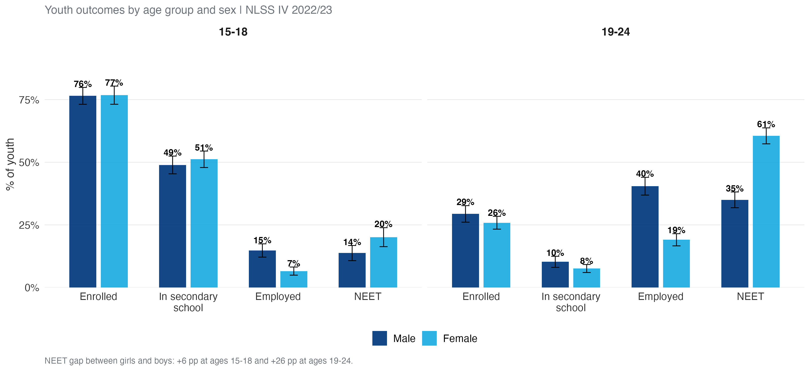{fig-align="center" height="72%"}

::: {.content-visible when-format="beamer"}

```{=latex}
\takeaway{Equal enrolment at 15--18. At 19--24: employed 19\% vs 40\%, NEET 61\% vs 35\%.}
```

:::

::: {.content-visible unless-format="beamer"}

**Equal enrolment at 15–18. At 19–24: employed 19% vs 40%, NEET 61% vs 35%.**

:::

# 2. See Who Is Most Affected {.section-divider background-color="#00377C"}

## Female NEET Is Highest in Madhesh and Lumbini

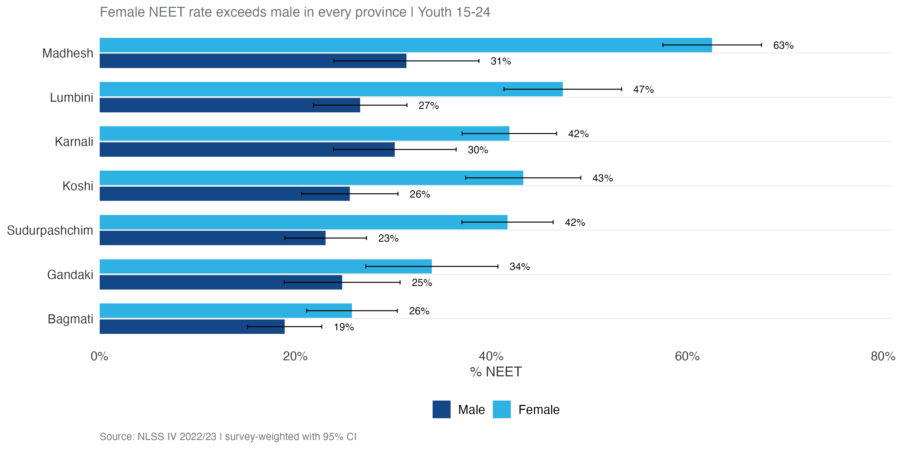{fig-align="center" height="72%"}

::: {.content-visible when-format="beamer"}

```{=latex}
\takeaway{Madhesh 63\%, Lumbini 47\%, Bagmati 26\%. Higher for women than men in every province.}
```

:::

::: {.content-visible unless-format="beamer"}

**Madhesh 63%, Lumbini 47%, Bagmati 26%. Higher for women than men in every province.**

:::

## Marriage Rises Sharply at the Ages When the Gap in Work Opens

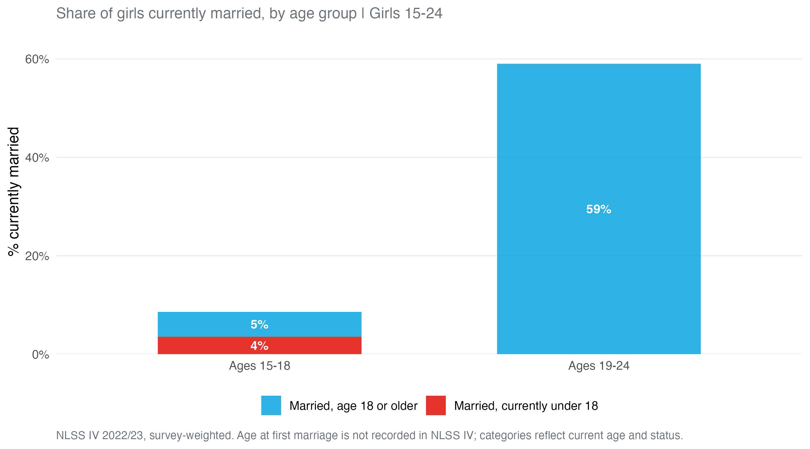{fig-align="center" height="70%"}

::: {.content-visible when-format="beamer"}

```{=latex}
\takeaway{9\% married at 15--18, 59\% at 19--24. Nepal’s legal minimum age of marriage is 20.}
```

:::

::: {.content-visible unless-format="beamer"}

**9% married at 15–18, 59% at 19–24. Nepal’s legal minimum age of marriage is 20.**

:::

\scriptsize

NLSS IV records current marital status, not age at first marriage.

## Why Girls Left School

```{r}
#| label: reasons
r <- read_csv("outputs/tables/key_reasons_left_school.csv", show_col_types = FALSE)
lab <- c("MARRIAGE" = "Marriage", "HAD TO HELP AT HOME" = "Had to help at home",
         "POOR ACADEMIC PROGRESS" = "Poor academic progress", "TOO EXPENSIVE" = "Too expensive",
         "PARENTS DID NOT WANT" = "Parents did not want", "STARTED WORKING/GOT A JOB" = "Started working",
         "TOO FAR AWAY" = "Too far away")
get <- function(a) { x <- r[r$age == a, ]; setNames(sprintf("%.0f%%", x$pct), x$reason)[names(lab)] }
tab <- data.frame(Reason = unname(lab), `Ages 15-18` = get("15-18"), `Ages 19-24` = get("19-24"),
                  `All 15-24` = get("15-24"), check.names = FALSE, row.names = NULL)
tab[is.na(tab)] <- "<1%"
knitr::kable(tab, align = "lrrr", format = "simple")
```

::: {.content-visible when-format="beamer"}

```{=latex}
\takeaway{Marriage is the main reason overall (37\%) and at 19--24 (41\%); at 15--18, poor academic progress leads.}
```

:::

::: {.content-visible unless-format="beamer"}

**Marriage is the main reason overall (37%) and at 19–24 (41%); at 15–18, poor academic progress leads.**

:::

\scriptsize

Girls aged 15–24 who attended school and are no longer enrolled, with a stated reason (n = 1,874). Survey-weighted.

## Married Girls Are Far More Likely to Be NEET, in Every Caste Group

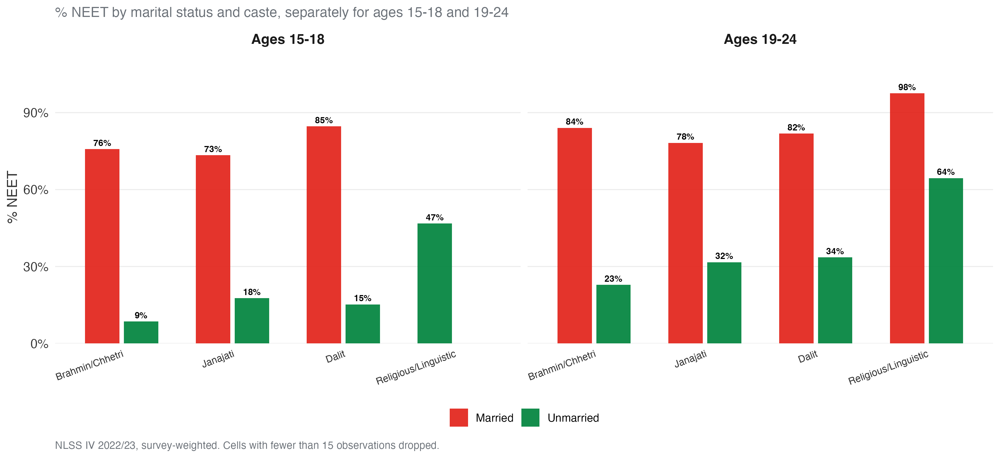{fig-align="center" height="72%"}

::: {.content-visible when-format="beamer"}

```{=latex}
\takeaway{82\% of married girls are NEET, against 20\% of unmarried girls.}
```

:::

::: {.content-visible unless-format="beamer"}

**82% of married girls are NEET, against 20% of unmarried girls.**

:::

## Married Girls’ Enrolment Collapses, in Every Caste Group

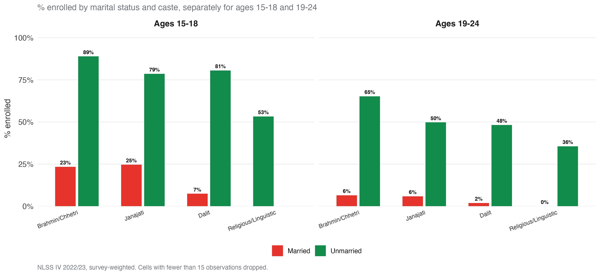{fig-align="center" height="72%"}

::: {.content-visible when-format="beamer"}

```{=latex}
\takeaway{Enrolment at 15--18: 17\% of married girls, 82\% of unmarried girls.}
```

:::

::: {.content-visible unless-format="beamer"}

**Enrolment at 15–18: 17% of married girls, 82% of unmarried girls.**

:::

# 3. Test What Drives It {.section-divider background-color="#00377C"}

## Enrolment: Marriage Outweighs Poverty, Caste and Location

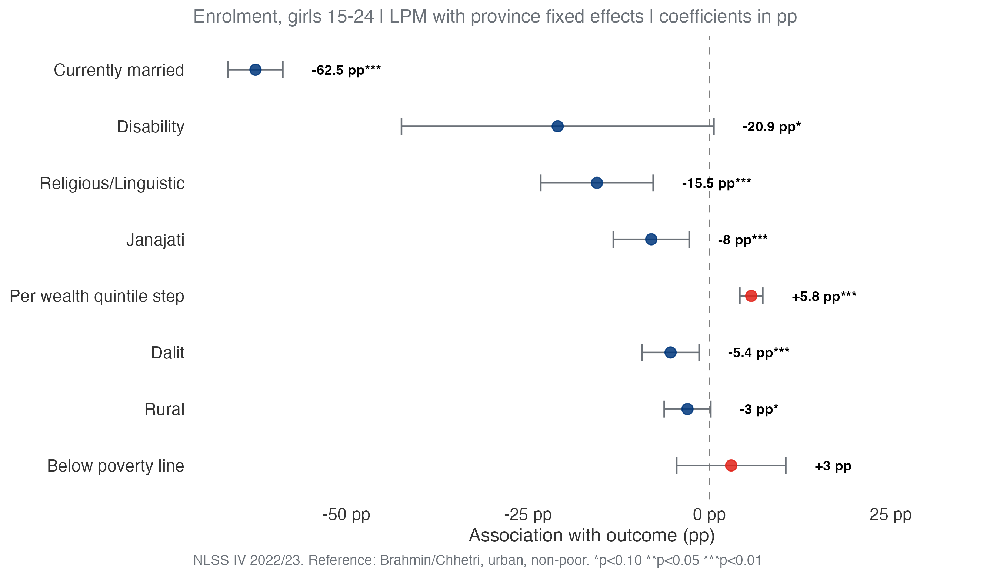{fig-align="center" height="74%"}

::: {.content-visible when-format="beamer"}

```{=latex}
\takeaway{Married −63 pp; religious/linguistic minority −16 pp; Dalit −5 pp; wealth step +6 pp.}
```

:::

::: {.content-visible unless-format="beamer"}

**Married −63 pp; religious/linguistic minority −16 pp; Dalit −5 pp; wealth step +6 pp.**

:::

\scriptsize

Linear probability model, girls 15–24, province fixed effects, survey-weighted, HC1 standard errors.

## NEET: Marriage Dominates, With a Residual Gender Gap

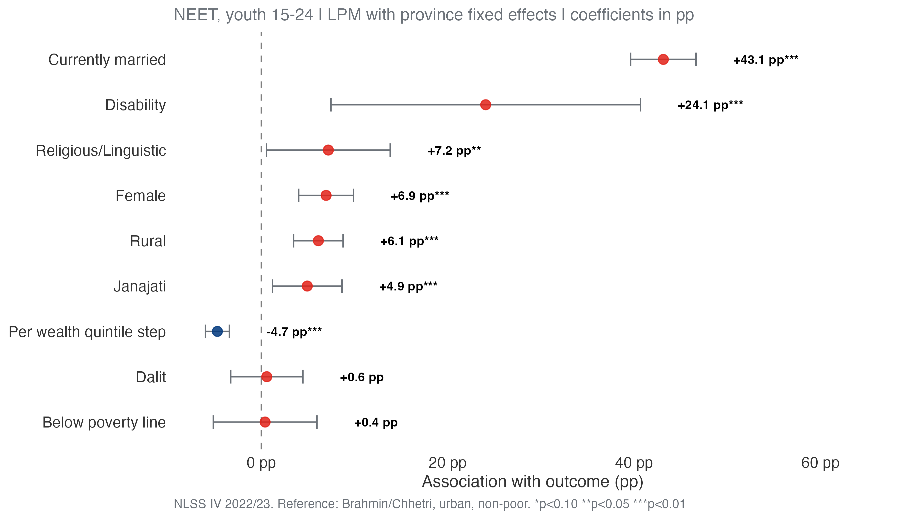{fig-align="center" height="74%"}

::: {.content-visible when-format="beamer"}

```{=latex}
\takeaway{Married +43 pp (girls only: +57 pp). Female +6.9 pp holding everything else constant.}
```

:::

::: {.content-visible unless-format="beamer"}

**Married +43 pp (girls only: +57 pp). Female +6.9 pp holding everything else constant.**

:::

\scriptsize

Linear probability model, youth 15–24, province fixed effects, survey-weighted, HC1 standard errors.

## The Marriage Association Is Strongest at Ages 15–18

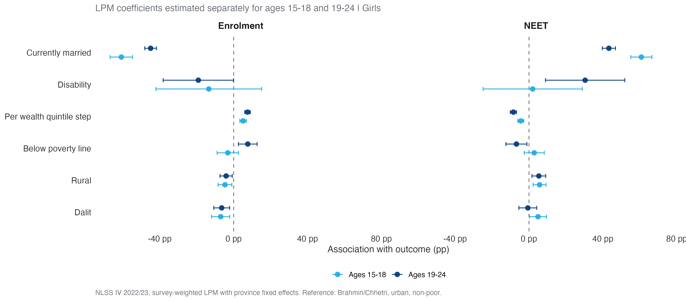{fig-align="center" height="72%"}

::: {.content-visible when-format="beamer"}

```{=latex}
\takeaway{Married girls: −61 pp enrolment and +61 pp NEET at 15--18; −45 pp and +43 pp at 19--24.}
```

:::

::: {.content-visible unless-format="beamer"}

**Married girls: −61 pp enrolment and +61 pp NEET at 15–18; −45 pp and +43 pp at 19–24.**

:::

## Schooling Beyond Grade 8 Lowers NEET by About 15 pp

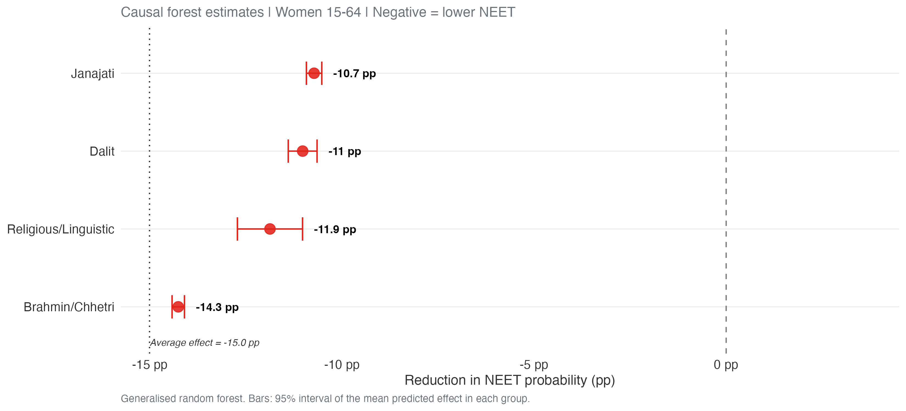{fig-align="center" height="70%"}

::: {.content-visible when-format="beamer"}

```{=latex}
\takeaway{Causal forest: −15.0 pp (95\% CI −21 to −9). Similar across caste groups.}
```

:::

::: {.content-visible unless-format="beamer"}

**Causal forest: −15.0 pp (95% CI −21 to −9). Similar across caste groups.**

:::

\scriptsize

Generalised random forest (Wager and Athey 2018), women 15–64 (n = 13,586). Treatment: completed grade 9 or above; outcome: NEET. Bars: 95% interval of the mean prediction in each group.

## The Effect Is Similar Across Provinces and Wealth Levels

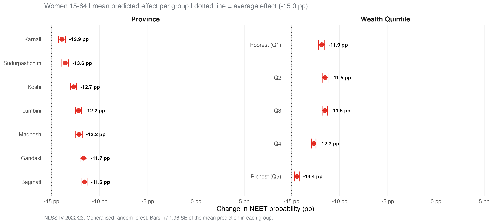{fig-align="center" height="72%"}

::: {.content-visible when-format="beamer"}

```{=latex}
\takeaway{Provinces −11.6 to −13.9 pp. The cost uses these provincial values (conservative).}
```

:::

::: {.content-visible unless-format="beamer"}

**Provinces −11.6 to −13.9 pp. The cost uses these provincial values (conservative).**

:::

## Marriage Weakens the Protection Schooling Gives

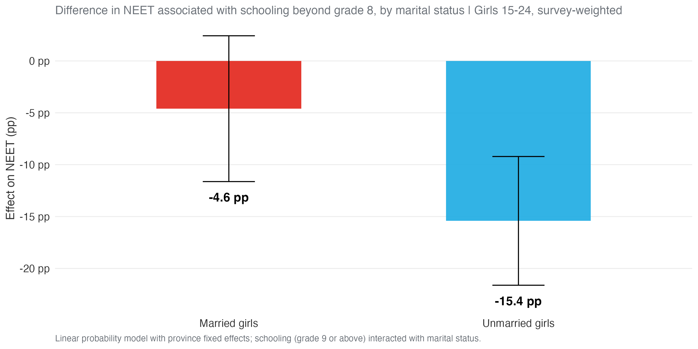{fig-align="center" height="72%"}

::: {.content-visible when-format="beamer"}

```{=latex}
\takeaway{Grade 9+: −15 pp NEET for unmarried girls, only −5 pp for married girls.}
```

:::

::: {.content-visible unless-format="beamer"}

**Grade 9+: −15 pp NEET for unmarried girls, only −5 pp for married girls.**

:::

## Where the Path Breaks

| Ages 19–24 | Women, grade 8 or below | Women, grade 9+ | Men, grade 8 or below | Men, grade 9+ |
|---|---:|---:|---:|---:|
| NEET | 85% | 49% | 41% | 32% |
| Employed | 14% | 22% | 57% | 32% |
| Enrolled | 2% | 37% | 2% | 43% |
| NEET, among those out of school | 86% | 78% | 42% | 56% |

\vspace{0.6em}

::: {.content-visible when-format="beamer"}

```{=latex}
\takeaway{Schooling lowers women’s NEET mostly by keeping them in education. Out of school, 78\% are NEET.}
```

:::

::: {.content-visible unless-format="beamer"}

**Schooling lowers women’s NEET mostly by keeping them in education. Out of school, 78% are NEET.**

:::

# 4. Value Schooling {.section-divider background-color="#00377C"}

## Each Level of Schooling Multiplies Women’s Earnings

{fig-align="center" height="72%"}

::: {.content-visible when-format="beamer"}

```{=latex}
\takeaway{+14.3\% per year for women, +9.3\% for men. Women: ×2.5 with secondary, ×7.6 with higher secondary.}
```

:::

::: {.content-visible unless-format="beamer"}

**+14.3% per year for women, +9.3% for men. Women: ×2.5 with secondary, ×7.6 with higher secondary.**

:::

## In Rupees, Men Still Earn More at Every Level

{fig-align="center" height="72%"}

::: {.content-visible when-format="beamer"}

```{=latex}
\takeaway{The gap narrows as schooling rises.}
```

:::

::: {.content-visible unless-format="beamer"}

**The gap narrows as schooling rises.**

:::

## The Return Is Robust Across Specifications

{fig-align="center" height="62%"}

::: {.content-visible when-format="beamer"}

```{=latex}
\takeaway{14.3\% main, 14.4\% unweighted, 14.5\% Heckman. The 9\% used for the cost is below all of them.}
```

:::

::: {.content-visible unless-format="beamer"}

**14.3% main, 14.4% unweighted, 14.5% Heckman. The 9% used for the cost is below all of them.**

:::

# 5. Add Up the Cost {.section-divider background-color="#00377C"}

## Ingredients of the Cost of Inaction

\small

| Ingredient | Value | Source |
|---|---|---|
| Girls aged 15–24 | 2.96 million | Census 2021 |
| Share who stopped at grade 8 or below | 33.8% (Madhesh 56%, Bagmati 18%) | NLSS IV |
| Girls affected, $N_p$ | **1.0 million** (743,000 out of school) | Census × NLSS IV |
| Effect of grade 9+ on NEET, $\tau_p$ | 11.6 to 13.9 pp by province | Causal forest |
| Monthly wage, $w_p$ | NPR 1,042 to 7,000 by province | NLSS IV, women wage earners |
| Return per year of schooling, $r$ | **9%** (survey estimate: 14.3%) | ILO benchmark |
| Extra years of schooling | 2 | Assumption |
| Working life and discount rate | 35 years at 5% | Assumption |

## The Formula

$$
\text{CoI}_p = \tau_p \times N_p \times 12\,w_p \times \left[(1+r)^2 - 1\right] \times \sum_{t=1}^{35} \frac{1}{(1.05)^t}
$$

\vspace{0.4em}

| Term | Meaning | Value |
|---|---|---|
| $\tau_p \times N_p$ | Girls who move out of NEET | about 124,000 |
| $12\,w_p$ | Annual wage in the province | NPR 12,500 to 84,000 |
| $(1+r)^2 - 1$ | Earnings gain from two more years at 9% | 18.8% |
| $\sum_{t=1}^{35} 1.05^{-t}$ | Present value of 1 rupee a year for 35 years | 16.4 |
| $\sum_p \text{CoI}_p$ | National cost | **NPR 10.8 bn** |

## Provincial Inputs and Results

\footnotesize

| Province | Girls 15–24 | Grade 8 or below | $N_p$ | $\tau_p$ (pp) | $w_p$ (NPR) | CoI (NPR bn) | Share |
|---|---:|---:|---:|---:|---:|---:|---:|
| Madhesh | 683,629 | 56.1% | 383,632 | 12.2 | 2,000 | 3.45 | 32.0% |
| Bagmati | 613,274 | 18.1% | 110,759 | 11.6 | 7,000 | 3.32 | 30.8% |
| Koshi | 435,479 | 30.3% | 131,825 | 12.7 | 2,500 | 1.55 | 14.4% |
| Lumbini | 564,674 | 33.2% | 187,628 | 12.2 | 1,500 | 1.27 | 11.8% |
| Sudurpashchim | 280,298 | 31.2% | 87,409 | 13.6 | 1,042 | 0.46 | 4.2% |
| Gandaki | 201,673 | 22.4% | 45,189 | 11.7 | 2,292 | 0.45 | 4.1% |
| Karnali | 177,775 | 30.4% | 54,050 | 13.9 | 1,066 | 0.30 | 2.8% |
| **Nepal** | **2,956,804** | **33.8%** | **1,000,494** | | | **10.78** | **100%** |

::: {.content-visible when-format="beamer"}

```{=latex}
\takeaway{Madhesh: the most girls affected. Bagmati: the highest wages.}
```

:::

::: {.content-visible unless-format="beamer"}

**Madhesh: the most girls affected. Bagmati: the highest wages.**

:::

## NPR 10.8 Billion Against National Budgets

{fig-align="center" height="70%"}

::: {.content-visible when-format="beamer"}

```{=latex}
\takeaway{12.5\% of the health budget, 5.3\% of the education budget. About USD 81 per girl.}
```

:::

::: {.content-visible unless-format="beamer"}

**12.5% of the health budget, 5.3% of the education budget. About USD 81 per girl.**

:::

\scriptsize

A stock for the ten cohorts aged 15–24 today, not a yearly flow; each new cohort adds about NPR 1 billion. Budgets: health and education FY2024/25, social security allowances FY2022/23.

## Where the Cost Falls

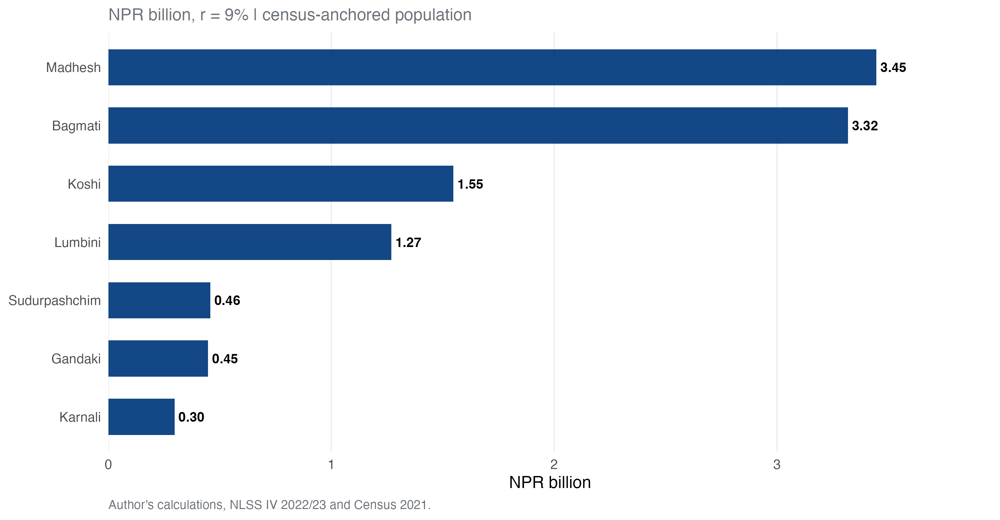{fig-align="center" height="72%"}

::: {.content-visible when-format="beamer"}

```{=latex}
\takeaway{Madhesh and Bagmati carry almost two thirds of the total.}
```

:::

::: {.content-visible unless-format="beamer"}

**Madhesh and Bagmati carry almost two thirds of the total.**

:::

## What Could Change the Result?

| Scenario | CoI (NPR bn) |
|---|---:|
| **Main estimate** ($r$ = 9%, provincial $\tau_p$) | **10.8** |
| $r$ = 12% | 14.6 |
| $r$ = 14.3% (NLSS IV estimate) | about 17.6 |
| $\tau$ at lower 95% bound (9 pp) | 6.4 |
| $\tau$ at upper 95% bound (21 pp) | 15.2 |
| Out-of-school girls only (743,000) | 7.9 |

\vspace{0.6em}

::: {.content-visible when-format="beamer"}

```{=latex}
\takeaway{From NPR 6 to 18 billion. Main caution: it assumes jobs exist for girls who gain schooling.}
```

:::

::: {.content-visible unless-format="beamer"}

**From NPR 6 to 18 billion. Main caution: it assumes jobs exist for girls who gain schooling.**

:::

# What It Means {.section-divider background-color="#00377C"}

## Five Headlines

\normalsize

1. **Nepal has closed the gender gap in school.** At 15–18, girls and boys are enrolled equally.
2. **The gap opens after school.** At 19–24, 61% of young women are NEET, against 35% of young men.
3. **Marriage is the turning point.** The main reason girls leave school; 82% of married girls are NEET.
4. **Secondary schooling pays, more for women.** Earnings ×2.5 with secondary, ×7.6 with higher secondary.
5. **Inaction costs NPR 10.8 billion,** and about NPR 1 billion more with every new cohort.

## Four Priorities

\normalsize

| | |
|---|---|
| **1. School-to-work pathways** | Skills bridges, TVET, apprenticeships, second-chance routes |
| **2. Secondary retention, year by year** | Returns highest in grades 9–12; reward every year retained |
| **3. Marriage prevention and re-entry** | Act before the ages when marriage rises; enforce the legal age of 20; flexible re-entry for married girls |
| **4. Equity** | Dalit, minority and disabled girls; Madhesh and Lumbini first |

## Thank You

::: {.content-visible when-format="beamer"}

```{=latex}
\vspace{1.6cm}
\begin{center}
{\fontsize{16pt}{20pt}\selectfont\bfseries Hernando Grueso-Hurtado, PhD\par}
\vspace{0.5em}
{\fontsize{13pt}{16pt}\selectfont UNICEF\par}
\vspace{0.5em}
{\fontsize{13pt}{16pt}\selectfont\color{uniceflight} hgrueso@unicef.org\par}
\end{center}
```

:::

::: {.content-visible unless-format="beamer"}

Hernando Grueso-Hurtado, PhD

UNICEF

hgrueso@unicef.org

:::

# Appendix {.section-divider background-color="#00377C"}

## Assumptions and Limitations {.smaller}

::: {.content-visible when-format="beamer"}

```{=latex}
\footnotesize
\begin{itemize}\setlength\itemsep{0.5em}
\item[\textbf{1.}] \textbf{Formal-sector selection bias.} Wages are observed only for the $\sim\,$25\% of women in wage employment. We test for this with a Heckman selection model (see appendix): selection is statistically significant ($\rho=0.33$, $p<0.01$) but correcting for it changes the estimated return by only 0.1 pp (14.4\% to 14.5\%), on the same specification as the main estimate. The conservative 9\% ILO benchmark sits below all estimates.
\item[\textbf{2.}] \textbf{NEET-to-earnings transition.} The estimate assumes a girl who exits NEET earns the median wage \textit{immediately}. In reality, job search, childcare, mobility, and social norms create friction that delays or reduces actual earnings. Assuming instant median-wage access therefore \textbf{overstates} the realised gain, making the cost-of-inaction figure an \textbf{upper bound} on what is realistically recoverable.
\item[\textbf{3.}] \textbf{Male migration not captured.} Boys leaving school for foreign employment generates remittances. The analysis does not yet quantify the parallel earnings that educated girls could generate through skilled migration.
\item[\textbf{4.}] \textbf{Population scaling and precision.} Survey weights reproduce the population closely (28.7M against a census of 29.2M). Absolute counts apply survey shares to the Census 2021 base, which gives almost the same number of girls aged 15--24 as the survey total (2.96M against 3.02M). The schooling effect has a 95\% interval of 9 to 21 pp, which alone implies a cost between NPR 6.4 and 15.2 billion.
\item[\textbf{5.}] \textbf{Partial equilibrium.} Earnings gains are valued at current wages and current labour demand, and assume employment opportunities exist for those who become qualified. If many more girls completed secondary at once, wages and job availability would adjust, so the average gain would be smaller than the marginal gain estimated here.
\end{itemize}
```

:::

::: {.content-visible unless-format="beamer"}

1. **Formal-sector selection bias.** Wages are observed only for the about 25% of women in wage employment. We test for this with a Heckman selection model (see appendix): selection is statistically significant (rho = 0.33, p < 0.01) but correcting for it changes the estimated return by only 0.1 pp (14.4% to 14.5%), on the same specification as the main estimate. The conservative 9% ILO benchmark sits below all estimates.

2. **NEET-to-earnings transition.** The estimate assumes a girl who exits NEET earns the median wage *immediately*. In reality, job search, childcare, mobility, and social norms create friction that delays or reduces actual earnings. Assuming instant median-wage access therefore **overstates** the realised gain, making the cost-of-inaction figure an **upper bound** on what is realistically recoverable.

3. **Male migration not captured.** Boys leaving school for foreign employment generates remittances. The analysis does not yet quantify the parallel earnings that educated girls could generate through skilled migration.

4. **Population scaling and precision.** Survey weights reproduce the population closely (28.7M against a census of 29.2M). Absolute counts apply survey shares to the Census 2021 base, which gives almost the same number of girls aged 15–24 as the survey total (2.96M against 3.02M). The schooling effect has a 95% interval of 9 to 21 pp, which alone implies a cost between NPR 6.4 and 15.2 billion.

5. **Partial equilibrium.** Earnings gains are valued at current wages and current labour demand, and assume employment opportunities exist for those who become qualified. If many more girls completed secondary at once, wages and job availability would adjust, so the average gain would be smaller than the marginal gain estimated here.

:::

## The Mincer Wage Equation: Specification {.smaller}

The Mincer human-capital earnings function is estimated as:

$$
\log(\text{wage}_{ip}) = \alpha + \beta_1 S_{ip} + \beta_2 S^2_{ip} + \beta_3 \cdot \text{exp}_{ip} + \beta_4 \cdot \text{exp}^2_{ip} + \beta_5 \cdot \text{rural}_{ip} + \text{caste}_{ip} + \gamma_p + \varepsilon_{ip}
$$

::: {style="font-size: 0.35em;"}
- $\log(\text{wage}_{ip})$: natural log of monthly wage (NPR) for individual $i$ in province $p$
- $S$: years of schooling (0 never attended, 5 primary, 8 lower secondary, 10 secondary, 12 higher secondary, 16 tertiary); $\beta_1 + 2\beta_2 S$ is the return to one more year at level $S$
- $\text{exp}$: years of potential labour market experience (age − schooling − 6)
- $\text{exp}^2$: captures concavity (returns to experience diminish with age)
- $\text{rural}$: binary indicator for rural residence
- $\gamma_p$: province fixed effects (regional wage differentials)
- $\varepsilon_{ip}$: error term, heteroskedasticity-robust SE (HC1)

**Result:** survey-weighted, all wage earners aged 15–64. The average return is **14.3% per year of schooling for women** and 9.3% for men. **Robustness (women):** unweighted 14.4%; long-term salaried workers only 12.9%; Heckman selection correction 14.5%. The ILO benchmark of 9% is used for the conservative CoI.
:::

## Appendix Table A1: Mincer Wage Equation, Women with Wage Earnings {.smaller}

```{r}
#| label: mincer-girls
if (file.exists("outputs/tables/mincer_girls_full.csv")) {
  mincer_girls <- read_csv("outputs/tables/mincer_girls_full.csv", show_col_types = FALSE)
  knitr::kable(mincer_girls, align = "lrrrr", caption = NULL, format = "simple")
}
```

::: {style="font-size: 0.35em; color: #555; line-height: 1.25; margin-top: 4px;"}
*Notes:* Dependent variable is log of monthly wage earnings (NPR). Sample: women aged 15–64 with wage earnings. Survey-weighted; reference caste group Brahmin/Chhetri. Standard errors are heteroskedasticity-robust (HC1). *Source*: Author's calculations using NLSS IV 2022/23.
:::

## Appendix Table A2: Mincer Wage Equation, Men with Wage Earnings {.smaller}

```{r}
#| label: mincer-boys
if (file.exists("outputs/tables/mincer_boys_full.csv")) {
  mincer_boys <- read_csv("outputs/tables/mincer_boys_full.csv", show_col_types = FALSE)
  knitr::kable(mincer_boys, align = "lrrrr", caption = NULL, format = "simple")
}
```

::: {style="font-size: 0.35em; color: #555; line-height: 1.25; margin-top: 4px;"}
*Notes:* Dependent variable is log of monthly wage earnings (NPR). Sample: men aged 15–64 with wage earnings. Survey-weighted; reference caste group Brahmin/Chhetri. Standard errors are heteroskedasticity-robust (HC1). *Source*: Author's calculations using NLSS IV 2022/23.
:::

## Appendix: Heckman Selection Model {.smaller}

Wages are observed only for women in wage employment (about 25% of working-age women). If the women who work differ systematically from those who do not, the Mincer return could be biased. We test this with a Heckman (1979) two-step model.

::: {.content-visible when-format="beamer"}

```{=latex}
\begin{itemize}\setlength\itemsep{0.6em}
\item \textbf{Selection equation} (probit): probability of being in the wage sample, with exclusion restrictions: children under 5, other adult women in household, household size, and wealth quintile (factors affecting participation, not the wage itself).
\item \textbf{Outcome equation}: the Mincer wage equation, corrected for selection via the inverse Mills ratio.
\item \textbf{Result}: selection is statistically significant ($\rho = 0.33$, inverse Mills ratio $p < 0.01$): there \textit{is} positive selection into wage work. But the correction changes the estimated return by only 0.1 pp (14.4\% to 14.5\%).
\item \textbf{Interpretation}: the Mincer estimates are robust to selection. This is \textit{not} a causal-identification claim (that rests on the causal forest); it addresses only sample selection into observed wages.
\end{itemize}
```

:::

::: {.content-visible unless-format="beamer"}

- **Selection equation** (probit): probability of being in the wage sample, with exclusion restrictions: children under 5, other adult women in household, household size, and wealth quintile (factors affecting participation, not the wage itself).

- **Outcome equation**: the Mincer wage equation, corrected for selection via the inverse Mills ratio.

- **Result**: selection is statistically significant (rho = 0.33, inverse Mills ratio p < 0.01): there *is* positive selection into wage work. But the correction changes the estimated return by only 0.1 pp (14.4% to 14.5%).

- **Interpretation**: the Mincer estimates are robust to selection. This is *not* a causal-identification claim (that rests on the causal forest); it addresses only sample selection into observed wages.

:::

## Appendix: Boys’ NEET Regression

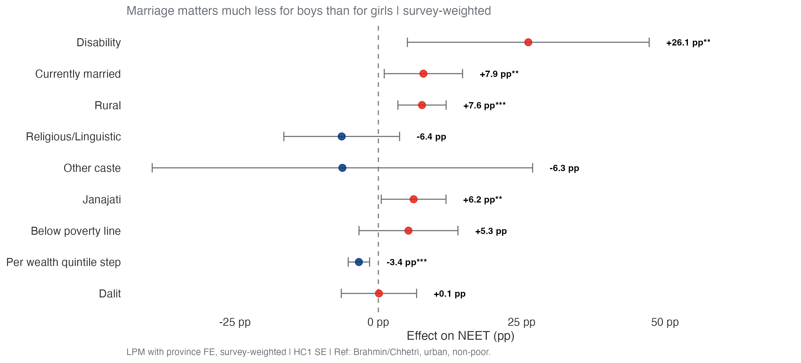{fig-align="center" height="72%"}

::: {.content-visible when-format="beamer"}

```{=latex}
\takeaway{Marriage matters much less for boys (+8 pp) than for girls (+57 pp).}
```

:::

::: {.content-visible unless-format="beamer"}

**Marriage matters much less for boys (+8 pp) than for girls (+57 pp).**

:::

## Appendix Table A3: Boys' NEET Linear Probability Model {.smaller}

```{r}
#| label: boys-reg
if (file.exists("outputs/tables/boys_reg_full.csv")) {
  boys_reg <- read_csv("outputs/tables/boys_reg_full.csv", show_col_types = FALSE)
  knitr::kable(boys_reg, align = "lrrrr", caption = NULL, format = "simple")
}
```

::: {style="font-size: 0.35em; color: #555; line-height: 1.25; margin-top: 4px;"}
*Notes:* Dependent variable is NEET status. Linear probability model. Sample: boys aged 15–24 (n = 2,984). Controls: rural, poverty status, wealth quintile, marital status, disability (WG 6+), caste/ethnicity. Reference categories: Brahmin/Chhetri, urban, non-poor. Province fixed effects included. Standard errors are heteroskedasticity-robust (HC1). *Source*: Author's calculations using NLSS IV 2022/23. \*p < 0.10, \*\*p < 0.05, \*\*\*p < 0.01.
:::

## Variables and Definitions {.smaller}

| Concept | Definition | Source |
|---|---|---|
| **NEET** | Not in education, employment or training | S07 + S09 |
| **Enrolled** | Currently attending any school level | q07_11 |
| **Secondary schooling** | Completed grade 9 or above (beyond basic education, grades 1–8) | q07_12 |
| **Currently married** | Self-reported marital status | q01_05 |
| **Caste/ethnicity** | 8 NLSS groups, recoded to 5 broad categories | q01_07 |
| **Wealth quintile** | Per-capita consumption quintile, household level | poverty file |
| **Below poverty line** | Official NSO poverty status | poverty file |
| **Disability** | Washington Group 6+ functional difficulty | q08_16–q08_21 |
| **Monthly wage** | Annual wage earnings / 12, all wage earners (salaried, daily, contract), NPR | S10 |
