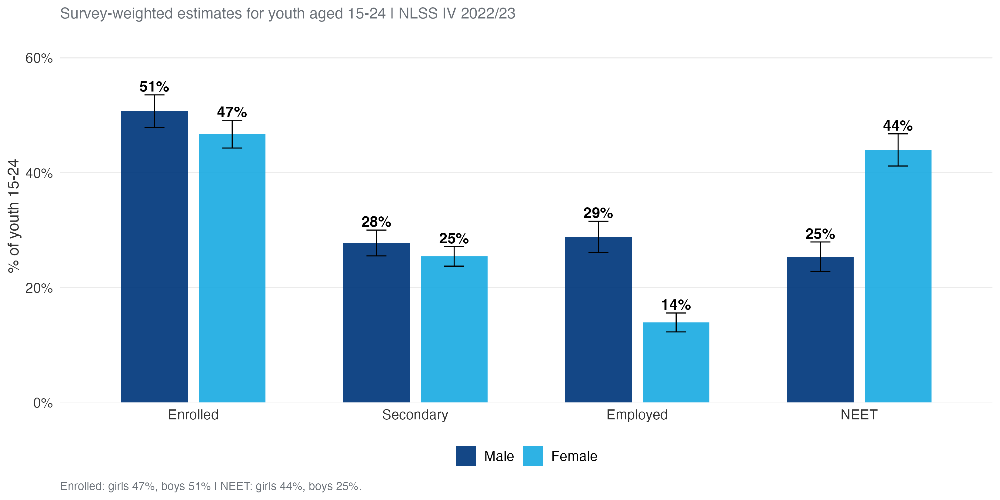
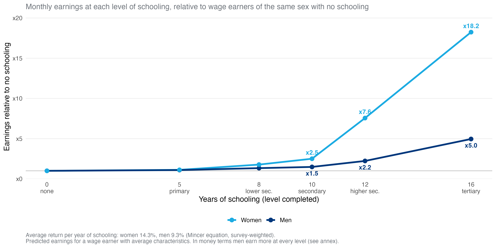
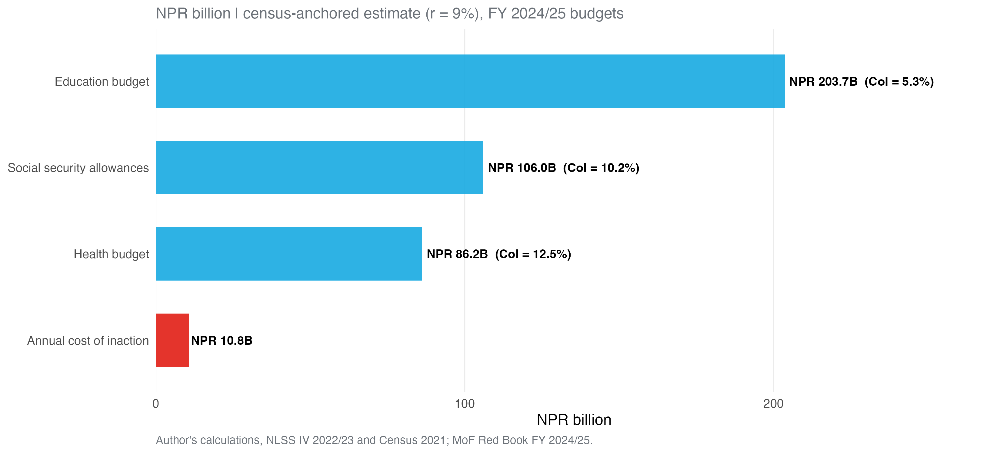
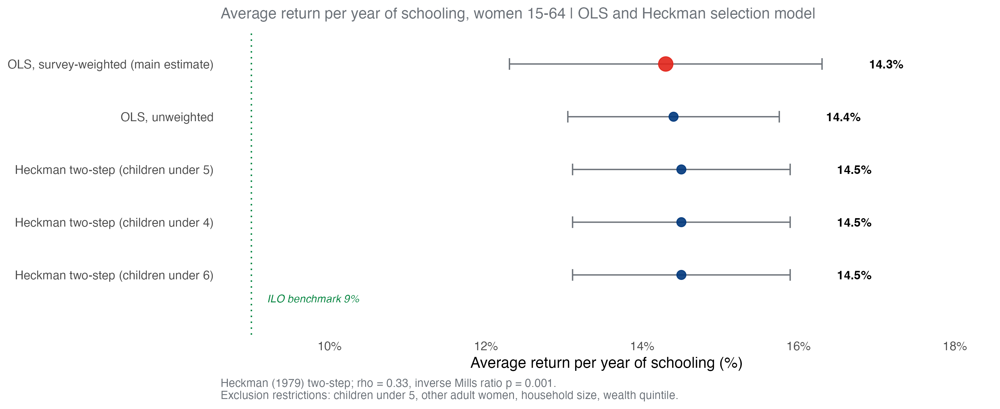
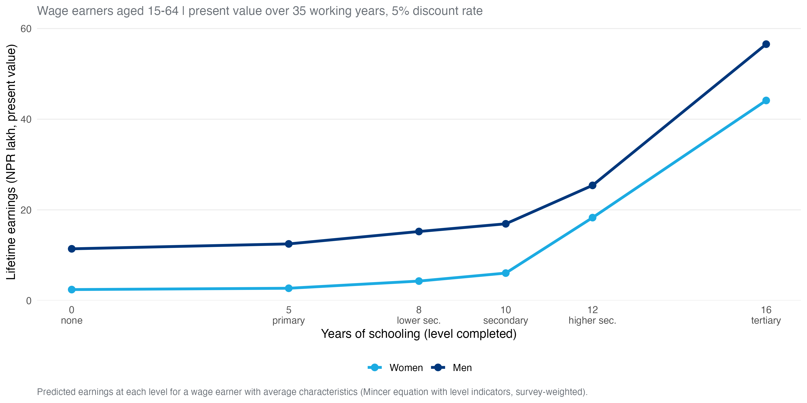

```{r setup}
knitr::opts_knit$set(root.dir = normalizePath(".."))
suppressPackageStartupMessages({
  library(dplyr); library(readr); library(knitr); library(glue)
})
options(knitr.kable.NA = "")
res <- tryCatch(readRDS("../outputs/census_anchor_results.RData"), error = function(e) NULL)
usd_npr <- 133
nums <- if (!is.null(res)) list(
  national_coi_b = round(res$coi_b_r09, 1), national_coi_b_r12 = round(res$coi_b_r12, 1),
  national_coi_usdm = round(res$coi_b_r09 * 1e9 / usd_npr / 1e6),
  national_excluded = round(res$N_excluded), girls_1524 = round(res$N_f1524_census),
  coi_pct_health_budget = round(100 * res$coi_b_r09 / 86.24, 1),
  coi_pct_ssallow_budget = round(100 * res$coi_b_r09 / 106, 1),
  coi_pct_education_budget = round(100 * res$coi_b_r09 / 203.66, 1),
  breakeven_usd = round(res$coi_b_r09 * 1e9 / usd_npr / res$N_excluded),
  girls_return_pct = 14.3, boys_return_pct = 9.3) else list(
  national_coi_b = 10.8, national_coi_b_r12 = 14.6, national_coi_usdm = 81,
  national_excluded = 1000494, girls_1524 = 2956804,
  coi_pct_health_budget = 12.5, coi_pct_ssallow_budget = 10.2, coi_pct_education_budget = 5.3,
  breakeven_usd = 81, girls_return_pct = 14.3, boys_return_pct = 9.3)
```


## Five Headline Findings {.smaller}

::: {.content-visible when-format="beamer"}

```{=latex}
\small
\begin{itemize}\setlength\itemsep{0.55em}
\item[\textbf{1.}] Nepal's gender gap \textbf{opens after school, in the transition to work}. At ages 15--18 girls and boys are enrolled at almost the same rate (77\% and 76\%). By ages 19--24, 61\% of young women are NEET against 35\% of young men. Across ages 15--24, NEET is 44\% for girls and 25\% for boys.
\item[\textbf{2.}] \textbf{Marriage is the strongest correlate of exclusion, and it begins in adolescence.} Being currently married is associated with 63 pp lower enrolment among girls and 43 pp higher NEET among all youth (57 pp among girls), and it is the main reason girls give for leaving school (37\%). The share married rises from 9\% at ages 15--18 (4\% of girls in this age group are married and still under 18) to 59\% at 19--24.
\item[\textbf{3.}] \textbf{Schooling beyond grade 8 is associated with lower exclusion}: a 15 pp lower NEET probability (95\% interval 9 to 21 pp), similar across provinces and caste groups (causal forest, n = 13{,}586).
\item[\textbf{4.}] \textbf{Each additional year of schooling is associated with 14.3\% higher earnings for women (9.3\% for men)}, and returns rise with the level: about 11\% per year at primary, 25\% at secondary and 30\% at higher secondary.
\item[\textbf{5.}] \textbf{About NPR 10.8 billion (USD 81 million) in lifetime earnings is forgone} by the 1.0 million girls aged 15--24 today who have not gone beyond grade 8, equivalent to \textbf{12.5\% of one year's health budget}, 10.2\% of the social-security-allowance budget and 5.3\% of the education budget. Each new yearly cohort adds about NPR 1 billion.
\end{itemize}
```

:::

::: {.content-visible unless-format="beamer"}

1. Nepal's gender gap **opens after school, in the transition to work**. At ages 15–18 girls and boys are enrolled at almost the same rate (77% and 76%). By ages 19–24, 61% of young women are NEET against 35% of young men. Across ages 15–24, NEET is 44% for girls and 25% for boys.

2. **Marriage is the strongest correlate of exclusion, and it begins in adolescence.** Being currently married is associated with 63 pp lower enrolment among girls and 43 pp higher NEET among all youth (57 pp among girls), and it is the main reason girls give for leaving school (37%). The share married rises from 9% at ages 15–18 (4% of girls in this age group are married and still under 18) to 59% at 19–24.

3. **Schooling beyond grade 8 is associated with lower exclusion**: a 15 pp lower NEET probability (95% interval 9 to 21 pp), similar across provinces and caste groups (causal forest, n = 13,586).

4. **Each additional year of schooling is associated with 14.3% higher earnings for women (9.3% for men)**, and returns rise with the level: about 11% per year at primary, 25% at secondary and 30% at higher secondary.

5. **About NPR 10.8 billion (USD 81 million) in lifetime earnings is forgone** by the 1.0 million girls aged 15–24 today who have not gone beyond grade 8, equivalent to **12.5% of one year's health budget**, 10.2% of the social-security-allowance budget and 5.3% of the education budget. Each new yearly cohort adds about NPR 1 billion.

:::

# Data and Method {.section-divider background-color="#00377C"}

## Data Source: Nepal Living Standards Survey IV (NLSS IV) 2022/23 {.smaller}

- **Source**: National Statistics Office of Nepal · NLSS IV 2022/23 microdata
- **Sampling**: Nationally representative two-stage stratified design across 7 provinces
- **Sample size**: 9,600 households; 38,101 household members (the roster also lists 8,769 people who are not household members; they were not asked about education or work and are excluded)
- **Analysis sample**: 6,950 youth aged 15–24 (3,966 girls, 2,984 boys); 13,586 women aged 15–64 for the causal forest
- **Modules used**: S01 (roster), S07 (education), S08 (disability, Washington Group), S09 (employment), S10 (wages), poverty file
- **Survey design**: PSU = `psu_number`, strata = province, person-level sampling weight; weighted members sum to 28.7 million (Census 2021: 29.2 million)

## Method: How We Estimate the Cost of Inaction {.smaller}

We combine three components:

\vspace{0.4em}

::: {.columns}
::: {.column width="50%"}

**1 · Causal effect**

Generalised Random Forest (Wager & Athey 2018) on women 15–64, treatment = completed grade 9 or above, outcome = NEET. Average effect = −15.0 pp.

\vspace{0.8em}

**2 · Earnings projection**

Mincer wage equation on 3,478 women with wage earnings. Conservative return = 9% per year of schooling (ILO benchmark, lower than the survey estimate of 14.3%).

:::
::: {.column width="50%"}

**3 · Population scaling**

Census-anchored: NLSS IV weighted shares applied to the Census 2021 female population (14.9M) give 2.96M girls aged 15–24, of whom 1.0M have not gone beyond grade 8. Provincial CoI = provincial effect × N × PV per girl.

\vspace{0.8em}

**Discount rate**: 5% | **Horizon**: 35 working years | **GDP source**: NSO Nepal 2023/24 provincial accounts.

:::
:::

# Key Findings {.section-divider background-color="#00377C"}

## The Gender Gap Opens After School, in the Transition to Work

{fig-align="center" width="86%"}

## Madhesh and Lumbini: Provinces with the Widest Female NEET Gap

{fig-align="center" width="76%"}

## Marriage Rises Sharply Across the Adolescent Transition

{fig-align="center" width="74%"}

::: {style="font-size: 0.35em; color: #555; margin-top: 4px;"}
NLSS IV records current marital status, not age at first marriage. Married girls under 18 (4% of girls aged 15–18) are in child marriage by definition. For older girls only current status is observed, so some of them also married before 18.
:::

## The Marriage Penalty on NEET Holds in Both Age Groups, Regardless of Caste

{fig-align="center" width="92%"}

## What is Associated with Girls' Enrolment: All Factors in Percentage Points

{fig-align="center" width="80%"}

## What the Regressions Show {.smaller}

- **Marriage is associated with the largest changes.** Being currently married is associated with a **−63 pp** lower enrolment probability among girls and a **+43 pp** higher NEET probability among all youth (+57 pp among girls alone), after controlling for poverty, caste, geography, and disability.

\vspace{0.6em}

- **Caste matters even after wealth.** Dalit girls face a −5 pp enrolment gap that does not disappear when we control for wealth quintile. The gap is larger for girls from religious and linguistic minority groups (−16 pp).

\vspace{0.6em}

- **Wealth helps incrementally.** Each step up in the wealth quintile is associated with +5.8 pp enrolment and −4.7 pp NEET.

\vspace{0.6em}

- **The gender coefficient on NEET remains +6.9 pp** even after holding everything constant, including marriage: a residual gap not explained by observable characteristics.

## Schooling Beyond Grade 8 Lowers NEET by About 15 pp, Across Caste Groups

{fig-align="center" width="74%"}

::: {style="font-size: 0.35em; color: #555; margin-top: 4px;"}
The average effect of −15.0 pp (95% interval −21 to −9) is for **women aged 15–64** and compares those who completed grade 9 or above with those who did not. Group values (−11 to −14 pp) are averages of the forest's individual predictions and are somewhat smaller than the overall estimate; the cost of inaction uses the provincial values, the more conservative choice. Details by province and wealth are in the appendix.
:::

## Schooling Raises Women's Earnings Far More Than Men's

{fig-align="center" width="70%"}

::: {style="font-size: 0.32em; color: #555; line-height: 1.25; margin-top: 4px;"}
**Average return:** +14.3% per year of schooling for women vs +9.3% for men, among wage earners. Compared with wage earners of the same sex with no schooling, women with secondary schooling earn **2.5 times** as much and women with higher secondary **7.6 times**; for men the multiples are 1.5 and 2.2. In money terms men still earn more at every level (annex).
:::

## Marriage Erodes the Protective Effect of Education

{fig-align="center" width="80%"}

# The Cost of Inaction {.section-divider background-color="#00377C"}

## NPR 11 Billion in Lifetime Earnings Forgone by Today's Girls Aged 15–24

{fig-align="center" width="84%"}

## Where the Cost Falls: Provincial Distribution

{fig-align="center" width="78%"}

## What This Means in Concrete Policy Terms {.smaller}

\footnotesize

- **NPR `r nums$national_coi_b` billion (USD `r nums$national_coi_usdm` million)** is the lifetime earnings forgone by the `r format(nums$national_excluded, big.mark = ",")` **girls aged 15–24 today who have not gone beyond grade 8** (about 743,000 are out of school; 257,000 are still enrolled at grade 8 or below). Counts are **census-anchored**: NLSS IV shares applied to the 2021 Census female population (`r format(nums$girls_1524, big.mark = ",")` girls aged 15–24); the survey's own weighted total is almost the same (3.02 million).

\vspace{0.2em}

- That equals about **`r nums$coi_pct_health_budget`% of one year's national health-sector budget** (NPR 86.2B, FY2024/25), **`r nums$coi_pct_ssallow_budget`% of the social security allowance budget** (NPR 106B, FY2022/23), and **`r nums$coi_pct_education_budget`% of the education-sector budget** (NPR 203.7B, FY2024/25).

\vspace{0.2em}

- **Madhesh carries the largest burden**: 32% of the total (NPR 3.4 billion) and about 0.5% of provincial GDP, against less than 0.2% in every other province. Bagmati follows (NPR 3.3 billion) because wages there are higher.

\vspace{0.2em}

- **This is a stock, not a yearly flow.** It covers the ten yearly cohorts aged 15–24 today. Each new cohort that reaches adulthood without going beyond grade 8 (about 96,000 girls) adds roughly **NPR 1 billion**. The 9% ILO return is conservative: a 12% return gives NPR `r nums$national_coi_b_r12` billion and the 14.3% estimated in this survey about NPR 17.6 billion. Statistical uncertainty in the schooling effect alone implies a range of NPR 6.4 to 15.2 billion.

\vspace{0.2em}

- **Break-even spending per girl.** USD `r nums$national_coi_usdm` million / `r format(nums$national_excluded, big.mark = ",")` girls = about **USD `r nums$breakeven_usd` per girl** in cumulative lifetime social spending. *Important caveat:* this is the spending threshold below which a programme pays for itself only if the modelled education and employment gains are achieved, including that girls who leave NEET earn the median wage. It is best read as the **theoretical maximum** spend that would still break even, not a prediction of per-girl returns.

# Recommendations and Next Steps {.section-divider background-color="#00377C"}

## Four Priority Areas for Investment: Employment Opportunities First {.smaller}

::: {.content-visible when-format="beamer"}

```{=latex}
\small
\begin{itemize}\setlength\itemsep{0.3em}
\item[\textbf{1.}] \textbf{Livelihoods: pathways from education to employment.} Every gain in this report assumes jobs exist for newly qualified young women; the estimates are partial-equilibrium and depend on labour demand. Pair education with demand-side measures: skills bridges from upper-secondary to work, TVET, apprenticeships, second-chance and return-to-education pathways, and investment in employment-generating sectors. This is an explicit budget trade-off, to be planned together with education rather than in competition with it.
\item[\textbf{2.}] \textbf{Education: universal secondary completion with year-by-year retention.} Each year of schooling is associated with 14.3\% higher earnings for women, and returns are \textit{convex}, rising from $\sim$11\% per year at primary to $\sim$25\% at secondary and $\sim$30\% at higher secondary. Programme design should reward \textit{every year retained}, with the largest gains in upper-secondary.
\item[\textbf{3.}] \textbf{Marriage: treat prevention as an economic priority, starting in adolescence.} Marriage is by far the strongest correlate of girls' NEET and the main reason girls give for leaving school (37\%); the married share rises from 9\% at ages 15--18 to 59\% at 19--24, and the penalty is severe in both groups. Dropout is itself a risk factor for child marriage, so retention and prevention reinforce each other. Enforcement, concentrated in Madhesh and Lumbini, must reach girls \textit{before} the post-18 transition.
\item[\textbf{4.}] \textbf{Equity: close the gaps facing Dalit and minority girls.} Dalit girls' enrolment is about 5 pp lower even after controlling for wealth, and the gap is larger for girls from religious and linguistic minority groups (about 16 pp). Pair education investment with apprenticeships, targeted scholarships, and anti-discrimination measures.
\end{itemize}
```

:::

::: {.content-visible unless-format="beamer"}

1. **Livelihoods: pathways from education to employment.** Every gain in this report assumes jobs exist for newly qualified young women; the estimates are partial-equilibrium and depend on labour demand. Pair education with demand-side measures: skills bridges from upper-secondary to work, TVET, apprenticeships, second-chance and return-to-education pathways, and investment in employment-generating sectors. This is an explicit budget trade-off, to be planned together with education rather than in competition with it.

2. **Education: universal secondary completion with year-by-year retention.** Each year of schooling is associated with 14.3% higher earnings for women, and returns are *convex*, rising from about 11% per year at primary to about 25% at secondary and about 30% at higher secondary. Programme design should reward *every year retained*, with the largest gains in upper-secondary.

3. **Marriage: treat prevention as an economic priority, starting in adolescence.** Marriage is by far the strongest correlate of girls' NEET and the main reason girls give for leaving school (37%); the married share rises from 9% at ages 15–18 to 59% at 19–24, and the penalty is severe in both groups. Dropout is itself a risk factor for child marriage, so retention and prevention reinforce each other. Enforcement, concentrated in Madhesh and Lumbini, must reach girls *before* the post-18 transition.

4. **Equity: close the gaps facing Dalit and minority girls.** Dalit girls' enrolment is about 5 pp lower even after controlling for wealth, and the gap is larger for girls from religious and linguistic minority groups (about 16 pp). Pair education investment with apprenticeships, targeted scholarships, and anti-discrimination measures.

:::

## Reaching Those Already Left Behind {.smaller}

::: {.content-visible when-format="beamer"}

```{=latex}
\small
The four priorities need to reach three groups explicitly.
\vspace{0.5em}
\begin{itemize}\setlength\itemsep{0.5em}
\item[\textbf{a.}] \textbf{Young people with disabilities.} Disability is associated with about \textbf{+24 pp NEET} among youth aged 15--24 and about \textbf{$-$21 pp enrolment} among girls (few cases in the sample, so both estimates are imprecise). Include accessible schooling, reasonable accommodations and support for the transition into work. The analysis does not identify which disability-specific measures work best.
\item[\textbf{b.}] \textbf{Girls already married or out of school.} Married girls show very low enrolment and high NEET in every caste group and in both age groups. Prevention alone misses those already excluded: include flexible re-entry, second-chance learning and employment support. Childcare is an option worth assessing; it is not evaluated here.
\item[\textbf{c.}] \textbf{Madhesh and Lumbini.} Female NEET reaches about \textbf{63\% in Madhesh and 47\% in Lumbini}, the highest of the seven provinces. Prioritise both for integrated education-to-employment support, not only marriage enforcement. Madhesh also carries the largest cost of inaction (NPR 3.4 billion, about a third of the total).
\end{itemize}
```

:::

::: {.content-visible unless-format="beamer"}

The four priorities need to reach three groups explicitly.

- **Young people with disabilities.** Disability is associated with about **+24 pp NEET** among youth aged 15–24 and about **−21 pp enrolment** among girls (few cases in the sample, so both estimates are imprecise). Include accessible schooling, reasonable accommodations and support for the transition into work. The analysis does not identify which disability-specific measures work best.

- **Girls already married or out of school.** Married girls show very low enrolment and high NEET in every caste group and in both age groups. Prevention alone misses those already excluded: include flexible re-entry, second-chance learning and employment support. Childcare is an option worth assessing; it is not evaluated here.

- **Madhesh and Lumbini.** Female NEET reaches about **63% in Madhesh and 47% in Lumbini**, the highest of the seven provinces. Prioritise both for integrated education-to-employment support, not only marriage enforcement. Madhesh also carries the largest cost of inaction (NPR 3.4 billion, about a third of the total).

:::

## For Collective Reflection {.smaller}

1. **Do the findings match what we see?** Which results fit the experience of the programme and the field offices, and which are surprising or need more explanation?

2. **Married and out-of-school girls.** Where does our adolescent girls programming reach them today, and what would second-chance and re-entry support look like?

3. **Madhesh and Lumbini.** What would an integrated package from education to employment look like there, and who needs to be at the table?

4. **From school to work.** Which partners and sectors can connect upper-secondary schooling and skills with jobs for young women?

5. **Using the numbers.** Which messages matter most, and for which counterparts (education, finance, provincial and local governments)?

## Possible Next Steps, for Discussion {.smaller}

- **Finalise the report** with inputs from the country office, including Flash Report figures and Nepal references on why girls leave school.

- **Shape the recommendations together**, so they reflect UNICEF Nepal's adolescent girls programming and priorities.

- **Share with government counterparts**, using the two-page summary and the slides.

- **Move from cost of inaction to an investment case**: cost a priority package of interventions and compare its cost per girl with the break-even threshold of about USD 81.

- **Agree a few indicators to track** with national data: secondary completion, NEET by sex and province, and marriage.

## Thank You

::: {.content-visible when-format="beamer"}

```{=latex}
\vspace{1.6cm}
\begin{center}
{\fontsize{16pt}{20pt}\selectfont\bfseries Hernando Grueso-Hurtado, PhD\par}
\vspace{0.5em}
{\fontsize{13pt}{16pt}\selectfont UNICEF\par}
\vspace{0.5em}
{\fontsize{13pt}{16pt}\selectfont\color{uniceflight} hgrueso@unicef.org\par}
\end{center}
```

:::

::: {.content-visible unless-format="beamer"}

Hernando Grueso-Hurtado, PhD

UNICEF

hgrueso@unicef.org

:::

# Appendix {.section-divider background-color="#00377C"}

## Assumptions and Limitations {.smaller}

::: {.content-visible when-format="beamer"}

```{=latex}
\footnotesize
\begin{itemize}\setlength\itemsep{0.5em}
\item[\textbf{1.}] \textbf{Formal-sector selection bias.} Wages are observed only for the $\sim\,$25\% of women in wage employment. We test for this with a Heckman selection model (see appendix): selection is statistically significant ($\rho=0.33$, $p<0.01$) but correcting for it changes the estimated return by only 0.1 pp (14.4\% to 14.5\%), on the same specification as the main estimate. The conservative 9\% ILO benchmark sits below all estimates.
\item[\textbf{2.}] \textbf{NEET-to-earnings transition.} The estimate assumes a girl who exits NEET earns the median wage \textit{immediately}. In reality, job search, childcare, mobility, and social norms create friction that delays or reduces actual earnings. Assuming instant median-wage access therefore \textbf{overstates} the realised gain, making the cost-of-inaction figure an \textbf{upper bound} on what is realistically recoverable.
\item[\textbf{3.}] \textbf{Male migration not captured.} Boys leaving school for foreign employment generates remittances. The analysis does not yet quantify the parallel earnings that educated girls could generate through skilled migration.
\item[\textbf{4.}] \textbf{Population scaling and precision.} Survey weights reproduce the population closely (28.7M against a census of 29.2M). Absolute counts apply survey shares to the Census 2021 base, which gives almost the same number of girls aged 15--24 as the survey total (2.96M against 3.02M). The schooling effect has a 95\% interval of 9 to 21 pp, which alone implies a cost between NPR 6.4 and 15.2 billion.
\item[\textbf{5.}] \textbf{Partial equilibrium.} Earnings gains are valued at current wages and current labour demand, and assume employment opportunities exist for those who become qualified. If many more girls completed secondary at once, wages and job availability would adjust, so the average gain would be smaller than the marginal gain estimated here.
\end{itemize}
```

:::

::: {.content-visible unless-format="beamer"}

1. **Formal-sector selection bias.** Wages are observed only for the about 25% of women in wage employment. We test for this with a Heckman selection model (see appendix): selection is statistically significant (rho = 0.33, p < 0.01) but correcting for it changes the estimated return by only 0.1 pp (14.4% to 14.5%), on the same specification as the main estimate. The conservative 9% ILO benchmark sits below all estimates.

2. **NEET-to-earnings transition.** The estimate assumes a girl who exits NEET earns the median wage *immediately*. In reality, job search, childcare, mobility, and social norms create friction that delays or reduces actual earnings. Assuming instant median-wage access therefore **overstates** the realised gain, making the cost-of-inaction figure an **upper bound** on what is realistically recoverable.

3. **Male migration not captured.** Boys leaving school for foreign employment generates remittances. The analysis does not yet quantify the parallel earnings that educated girls could generate through skilled migration.

4. **Population scaling and precision.** Survey weights reproduce the population closely (28.7M against a census of 29.2M). Absolute counts apply survey shares to the Census 2021 base, which gives almost the same number of girls aged 15–24 as the survey total (2.96M against 3.02M). The schooling effect has a 95% interval of 9 to 21 pp, which alone implies a cost between NPR 6.4 and 15.2 billion.

5. **Partial equilibrium.** Earnings gains are valued at current wages and current labour demand, and assume employment opportunities exist for those who become qualified. If many more girls completed secondary at once, wages and job availability would adjust, so the average gain would be smaller than the marginal gain estimated here.

:::

## Appendix: Causal Forest Effects by Province and Wealth {.smaller}

{fig-align="center" width="88%"}

\scriptsize

Generalised random forest (Wager and Athey 2018), women aged 15–64 (N = 13,586); treatment = completed grade 9 or above, outcome = NEET. Average effect −15.0 pp (dotted line). Points are the mean predicted effect in each group; bars are ±1.96 standard errors of that mean, so they show how tightly predictions cluster rather than full estimation uncertainty. Group values are somewhat smaller than the overall estimate because individual predictions are pulled toward the centre. The provincial values are the ones used in the cost-of-inaction calculation, the more conservative choice; effects by caste are on the main slide on education returns.

## Appendix: Returns are Robust Across Specifications {.smaller}

{fig-align="center" width="70%"}

\scriptsize

::: {style="font-size: 0.34em; color: #555; margin-top: 2px;"}
Average return per year of schooling, women 15–64. The main estimate (14.3%), the unweighted estimate (14.4%) and the Heckman-corrected estimate (14.5%) are nearly identical, and stable across the choice of child-age cutoff in the exclusion restriction. All use the same specification. The 9% ILO benchmark used for the cost-of-inaction calculation is below all estimates, which makes the CoI a conservative figure. Returns are convex: the return to one more year rises from about 11% at primary to 25% at secondary and 30% at higher secondary.
:::

## Appendix: Earnings by Schooling and Sex in Money Terms {.smaller}

{fig-align="center" width="80%"}

\scriptsize

In money terms men earn more than women at every level of schooling; the gap narrows as schooling rises. Present value of lifetime earnings for a wage earner with average characteristics (survey-weighted Mincer equation with level indicators).

## Variables and Definitions {.smaller}

| Concept | Definition | Source |
|---|---|---|
| **NEET** | Not in education, employment or training | S07 + S09 |
| **Enrolled** | Currently attending any school level | q07_11 |
| **Secondary schooling** | Completed grade 9 or above (beyond basic education, grades 1–8) | q07_12 |
| **Currently married** | Self-reported marital status | q01_05 |
| **Caste/ethnicity** | 8 NLSS groups, recoded to 5 broad categories | q01_07 |
| **Wealth quintile** | Per-capita consumption quintile, household level | poverty file |
| **Below poverty line** | Official NSO poverty status | poverty file |
| **Disability** | Washington Group 6+ functional difficulty | q08_16–q08_21 |
| **Monthly wage** | Annual wage earnings / 12, all wage earners (salaried, daily, contract), NPR | S10 |
