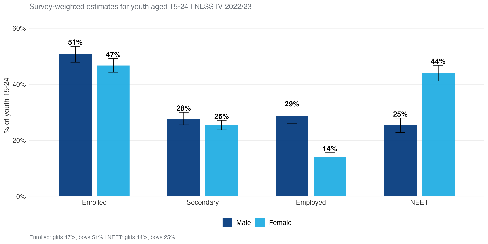
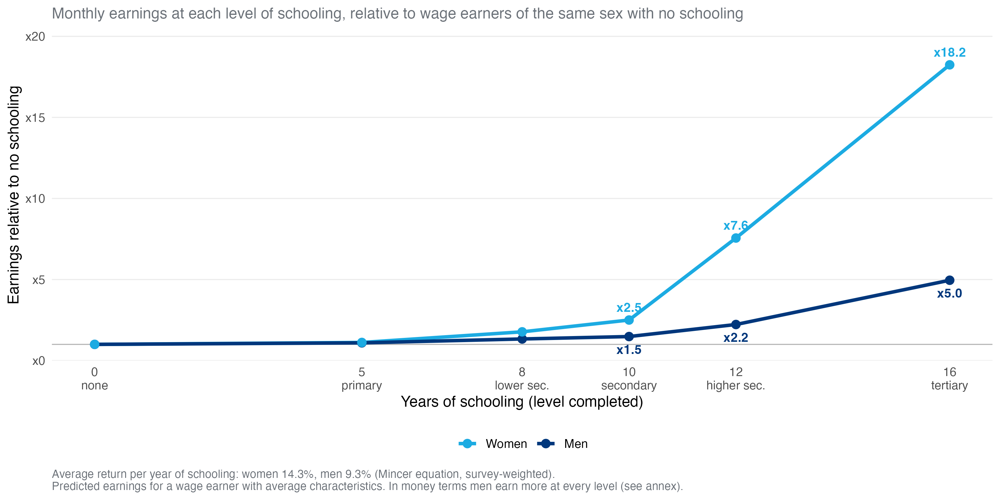
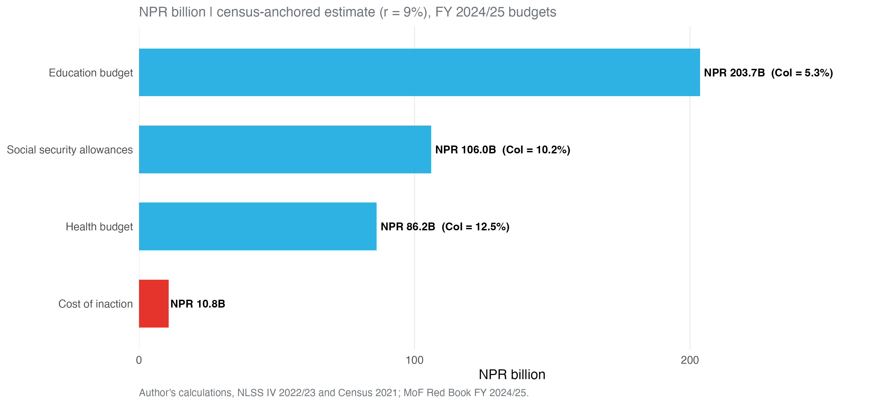
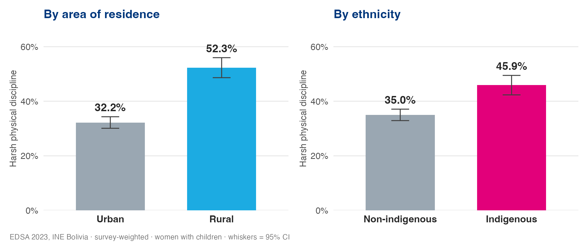
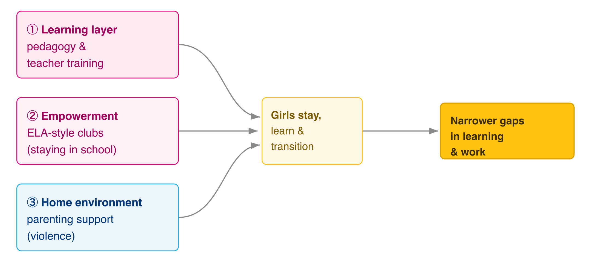

## The Problem: The Gap Opens After School {.smaller}

::: {.columns}
::: {.column width="55%"}
{fig-align="center" width="100%"}
:::
::: {.column width="45%"}

```{=latex}
\vspace{0.5cm}
\begin{itemize}\setlength\itemsep{0.6em}
\item At ages 15--18 girls and boys are enrolled at the same rate (\textbf{77\%}).
\item Yet girls' NEET (\textbf{44\%}) is far above boys' (25\%), and at ages 19--24 it reaches \textbf{61\%} against 35\%.
\item Nepal's gender gap opens in the \textbf{transition from school to work}.
\item Marriage is by far the strongest correlate of girls' NEET and the main reason girls give for leaving school (37\%). The share of girls married rises from \textbf{9\% at 15--18 to 59\% at 19--24} (among 15--18-year-olds any current marriage is child marriage by definition).
\end{itemize}
```

:::
:::

## The Evidence: Education Reduces Exclusion {.smaller}

::: {.columns}
::: {.column width="55%"}
{fig-align="center" width="100%"}
:::
::: {.column width="45%"}

```{=latex}
\vspace{0.4cm}
\begin{itemize}\setlength\itemsep{0.6em}
\item For girls and women, schooling beyond grade 8 is associated with a \textbf{15 pp} lower NEET probability (causal forest, $n=13{,}586$; 95\% interval 9 to 21 pp), similar across all 7 provinces and caste groups.
\item Each year of schooling: \textbf{+14.3\% earnings for women} vs +9.3\% for men.
\item Returns are \textbf{convex}, rising from $\sim$11\% per year at primary to $\sim$25\% at secondary and $\sim$30\% at higher secondary.
\item Estimates are \textbf{robust to a Heckman selection correction} (selection significant but changes the return by 0.1 pp).
\end{itemize}
```

:::
:::

## The Cost: NPR 11 Billion in Lifetime Earnings {.smaller}

::: {.columns}
::: {.column width="55%"}
{fig-align="center" width="100%"}
:::
::: {.column width="45%"}

```{=latex}
\vspace{0.4cm}
\begin{itemize}\setlength\itemsep{0.6em}
\item \textbf{NPR 10.8 billion (USD 81M)} is the lifetime earnings forgone by the 1.0 million girls aged 15--24 today who have not gone beyond grade 8 (counts anchored to the 2021 Census).
\item Equivalent to \textbf{12.5\% of one year's health budget}, \textbf{10.2\% of the social-security-allowance budget} and \textbf{5.3\% of the education budget}. With a 12\% return the loss is NPR 14.6 billion; the 9\% ILO headline is the conservative choice.
\item This covers ten yearly cohorts. \textit{Each new cohort} adds about NPR 1 billion.
\item Break-even: any programme costing under \textbf{USD 81 per girl} lifetime yields positive ROI, a theoretical maximum that assumes jobs are available on completion.
\end{itemize}
```

:::
:::

## The Recommendation: Four Priority Areas, Employment First {.smaller}

```{=latex}
\begin{itemize}\setlength\itemsep{0.7em}
\item[\textbf{1.}] \textbf{Livelihoods: pathways from education to employment.} Every gain assumes jobs exist for qualified young women. Pair upper-secondary retention with skills bridges, TVET, apprenticeships and return-to-education pathways, and invest in employment-generating sectors alongside education.
\item[\textbf{2.}] \textbf{Education: universal secondary completion with year-by-year retention.} 14.3\% higher earnings per year of schooling for women, rising through lower and upper secondary. Reward \textit{every year retained}, not only the completion milestone.
\item[\textbf{3.}] \textbf{Marriage: treat prevention as an economic priority, starting in adolescence.} Marriage is associated with $-$63 pp enrolment and $+$43 pp NEET, the largest single lever, and dropout is itself a risk factor for child marriage. Combine enforcement of existing legislation, social-norm change and social protection, concentrated in Madhesh and Lumbini, reaching girls \textit{before} the post-18 transition.
\item[\textbf{4.}] \textbf{Equity: close the gaps facing Dalit and minority girls.} Dalit girls' enrolment is about 5 pp lower even after controlling for wealth, and the gap is larger for religious and linguistic minority girls. Pair education with apprenticeships, scholarships and anti-discrimination measures.
\end{itemize}
```

## The Same Lens Elsewhere: Bolivia: a Different Diagnosis {.smaller}

{fig-align="center" width="84%"}

```{=latex}
\vspace{1pt}
{\fontsize{4.5pt}{5.5pt}\selectfont\color{gray}
In Bolivia (Aula Conectada investment case) girls are \textbf{already in school} ($\sim$92\% enrolment ages 10--19, no gender gap in access); the binding constraints are \textbf{learning quality, retention past 15, and the home environment}. Violent discipline is concentrated in rural (52\% vs 32\% urban) and indigenous (46\% vs 35\%) homes and is associated with $\sim$2 fewer years of schooling; \textbf{early pregnancy} is the strongest schooling correlate ($-$2.9 years). Contrast with Nepal: Nepal's gap is the school-to-work transition; Bolivia's is learning and retention: the same lens, a different policy answer. Source: EDSA 2023 (INE Bolivia), survey-weighted.\par}
```

## Bolivia: Evidence-Matched Theory of Change: BCR ≈ 4–6 {.smaller}

{fig-align="center" width="86%"}

```{=latex}
\vspace{1pt}
{\fontsize{4.5pt}{5.5pt}\selectfont\color{gray}
Each layer answers a diagnosed problem: \textbf{learning} (gender-responsive pedagogy --- Evans \& Yuan, 73+ RCTs), \textbf{empowerment} (ELA-style clubs --- the retention answer, incl.\ early pregnancy; Bandiera 2018, $\varphi$-adjusted), and \textbf{home environment} (parenting --- Cluver 2017 effect, Janowski 2025 delivery). Combined attendance effect $\approx$ +6.6 pp $\rightarrow$ +0.28 school-years $\rightarrow$ $\sim$USD 970 PV per girl; \textbf{BCR $\approx$ 4.1--6.1} (central $\sim$5.1), a conservative floor since learning gains (+0.06 SD) are not monetised. At full priority scale ($\sim$568{,}000 girls): $\sim$USD 551M lifetime earnings for $\sim$USD 107M invested.\par}
```

##  {.unnumbered}

\vfill

\begin{center}
{\fontsize{28pt}{34pt}\selectfont\bfseries\color{black} Thank you\par}
\vspace{1em}
{\fontsize{14pt}{17pt}\selectfont\color{black} Hernando Grueso, PhD\par}
\vspace{0.35em}
{\fontsize{13pt}{16pt}\selectfont\color{uniceflight} hgrueso@unicef.org\par}
\end{center}

\vfill
